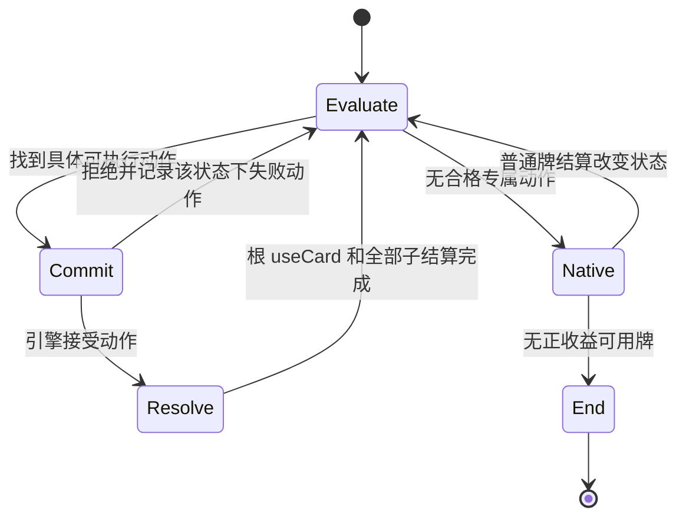

# 剑华 AI 决策树工程初案 v1

日期：2026-10-11。用户已确认本次所称“剑灵”指剑华。依据工作区现行 `module/jianhua.js` 和 v1.4 规则契约设计。本稿交付可编码的决策约定，不修改游戏机制。本轮 AI 实现、自动实机与胜率验证均未执行。

设计状态：已完成一轮独立对抗式审查，正文按审查发现修订。下述参数是首轮工程默认值，不是测得的最优策略。送审原稿保存在 `.audit/jianhua-ai-design.reviewed-draft.md`，最终稿没有进行第二轮独立复审。

2026-10-11 用户补充：允许收益足够高的附带友伤，例如三敌一友，或两敌两友但敌方有减员机会且友方健康。本次以第 3.2 节的整次攻击比较替换“有友伤一律否决”；该新增设计尚未独立复审或实现。

## 1. 从两个现有 AI 学什么

| 来源 | 采用 | 不照搬 |
| --- | --- | --- |
| 鲜血仪葬殷华 `xyDecideInitialRoute`、`xyShouldContinueLockedTarget`、`xyChooseCardsToKeep` | 决策返回动作和原因；实际结算后重算；留牌和出牌估值分开；只记录真正使用过的动作 | 四杀强制爆发、使用第一杀后放弃丹恩、被闪后整段停火。剑华的额外杀来自不同武器名，凝来自实际伤害 |
| 生潮息落绯 `luofeiDecideYinchaoSpend`、`luofeiScoreYinchaoTarget`、`luofeiDecideLiusheng` | 先查合法且正收益，再排目标；资源支付和目标选择分开；纯快照决策；可取消时明确返回 HOLD | 永久留一份资源。剑华没有“花凝”按钮，够费后换装自动支付，不应为凑六凝拒绝其他攻击 |

现行殷华的丹恩已经是“移去某角色血缠，自己回复”，与旧《殷华_妖决策树ver3》有差异。本稿仅借鉴现行代码的结构，不沿用旧规则。

考察了两种形态。第一种是长驻的“攒凝→爆发→收尾”状态机，但攒凝依赖伤害，等待资源又抑制攻击，容易自锁。采用第二种：每次出牌窗口枚举具体动作，选一步，结算后重算。只保留当前阶段的执行记录和短计划。

## 2. 决策必须遵守的机制

1. 每个完整回合，每种武器名只有第一次成功装备触发额外杀。第二次仍可装备，但不能再计作一刀。普通杀次数与额外杀分别计算。
2. 装备触发杀是强制的。没有合法目标才不使用；若只剩友方合法，不能先装备再指望取消。横刹强制加入范围内所有合法角色，包含友方。
3. 凝每实际造成一点伤害增加三。费用 `X=max(0,6-R)`，`R` 是本回合成功回收次数。换装时若已有旧武器且凝足够，自动支付并回收旧武器材料；否则旧武器正常弃置。费用先于新装备触发杀的伤害结算。
4. 灵刃武器被回收时，拿回的是原实体杀，不是凭空多一张实体武器。该杀重新占手牌上限。实体武器在手里不占上限。
5. 擢锋只有杀造成实际伤害后才获得目标武器。防止伤害、出闪、失去体力均不能预先算作拿到武器或获得凝。
6. 本回合未造成伤害，结束阶段从当时弃牌堆取第一张杀。出过杀但未命中仍可触发。不能把“保住补杀”写成禁止使用第一张杀。

## 3. 快照、动作与收益定义

快照 `S` 只读取自己的手牌、各方公开装备/体力/手牌数/标记/技能、合法性、态度及公开事件。不读取敌方隐藏手牌。

| 字段 | 计算 |
| --- | --- |
| `flow / cost / usedNames` | `countMark('nihil_xinliu')`、`flowCost(player)`、`getStorage('nihil_jianhua_skill_used')` |
| `normalShaLeft` | 当前引擎 `getCardUsable` 及实际牌的合法性；额外杀不从这里扣次数 |
| `oldWeapon / materials` | `getVEquips(1)` 及真实材料；多武器槽进入兼容回退，不假设数组首项代表全部 |
| `legalTargets(a)` | 当前普通杀使用原生合法性；换装杀计算新装备后的范围与禁选；横刹计算全部强制目标 |
| `positiveTargets(a)` | 合法敌方且基础伤害收益大于零；生命低、武器值高不能把零或负收益改成正收益 |
| `vulnerable(t)` | 当前手牌数不超过一，或公开记录中有合法出闪机会但未出闪，之后没有获得新手牌 |
| `execution(a,t)` | 正收益、无已知防伤，预计本刀伤害不小于体力，且目标脆弱或本刀已知不可响应。这只是抢杀信号，不宣称必杀 |
| `keyOldWeapon(a)` | 换掉后会失去当前已经能执行的一次额外普通杀（如连弩），或失去当前手中杀对唯一正收益敌人的攻击距离 |
| `overflow` | 引擎正常弃牌口径的计数手牌数减手牌上限；扣除免计数实体武器，不能直接用 `countCards('h')` |

枚举以下动作，牌和目标必须有具体 ID：

```text
NORMAL_SHA(cardId, targetIds)
EQUIP_WEAPON(cardId, expectedTargetIds)
LINGREN(cardId, zhuofeng|hengsha, expectedTargetIds)
SETUP(firstAction, exactFollowup)
NATIVE                  // 交回其他牌的原生 AI，不等于结束阶段
HOLD                    // 当前确实没有可获益动作
```

`SETUP` 最多包含一次不攻击的换装、用酒或控制装备，及紧接的一次攻击。例如卸横刹后打手中的杀、回收装备区原杀后使用它，或酒后装备未用名武器触发一刀。不展开第三步，不预测未知摸牌、未命中的凝或未到手的敌方武器。

一组相同材料只能占一个位置。例：手中唯一杀被用于灵刃后，不得又被计划为下一张普通杀；旧灵刃材料只有足额回收才进入后续可用牌集合。

### 3.1 正收益分档，资源花费参与比较

先剔除合法性失败、材料不可实现及不满足第 3.2 节承伤条件的候选，再给整个动作或二步计划定收益档 `B`：

| B | 条件 |
| --- | --- |
| 3 | 本刀存在 execution 目标 |
| 2 | 本次横刹能攻击至少两个正收益敌方 |
| 1 | 至少一次对敌方的普通正收益攻击，不满足上两档 |
| 0 | 没有可兑现的攻击。只允许第 5 节列出的独立整理动作 |

擢锋缴械只在同档、相近成本的候选间加优先级，不单独把一刀升为 B2，也不把缴械算入后续确定资源。正收益目标判断调用基础 `get.effect`，实际伤害与防伤另作公开状态检查。不要把引擎 effect 数值与凝数、牌价值直接相减。

对该计划记录成本档 `C`，只用于排序，不作为能否发动的通用门槛：

| 成本事实 | C |
| --- | --- |
| 普通杀；空武器栏装备；零费回收；旧牌只是预计本次弃牌中必弃的冗余杀材料 | 0 |
| 支付 1 至 3 凝回收；或者丢失一张非关键旧武器/非关键旧杀材料 | 1 |
| 支付 4 至 6 凝回收；或者丢失关键旧武器 | 2 |

同一动作取最高成本档，不把互斥的“回收”和“弃掉旧牌”同时计入。二步计划分别记录成本，若两步都有实际支付或丢牌，将最高档加一，上限三。普通杀与酒作为材料的支出不单独增档，但必须通过净材料数排序。

入围条件为 `B>=1`，且通过合法性、友伤和材料可实现性检查。六凝自动回收也允许普通正收益一刀。零凝的普通换装同样允许，不要求先凑六凝。没有实际攻击、也没有具体攻击后手时，不能仅因能回收或能降费入围。

凝只用于回收，首版不设永久保留量。若高费攻击有同收益低费替代，优先替代；若没有，允许花已有凝兑现攻击。这样凝从五增至六只改变排序和回收结果，不会单独使原先可做的攻击失效。

武器机会成本另算。`readyShots` 为只用当前已有杀、已核实次数与合法敌方，能够提交的普通杀数量，不假设命中。若换装后丢失连弩或距离能力，计算“本计划攻击次数 + 计划结束后 readyShots”与“不换装 readyShots”。若前者更少，且不提高抢杀档位、不增加安全正收益目标数、不移除横刹友伤，删去该换装候选，先执行当前攻击。仅旧武器能回到手里，不能当作它仍在装备栏生效。若需要重装才能恢复能力，这必须占计划中的实际步骤。

擢锋缴械加分必须同时满足：敌方武器有可获得的实体材料、没有公开获得阻断、取得材料或移除敌方装备能力有正收益、公开的失去装备收益没有抵消该收益。未知时不加分，仍可按普通伤害参与。缴械偏好不能越过更低成本、更高基础攻击收益的同档动作。

### 3.2 允许划算的附带友伤，按整次攻击判断

本节同时适用于横刹普通杀、装备触发杀，以及属性传导导致的附带友伤。单独主动攻击友方以刷凝不入围。中立不当成敌方收益；首版不批准会伤及中立的候选。

先根据实际攻击距离和所有修正取得完整目标集。减一马可以让更多角色进入横刹目标集，不能固定只检查座次相邻两人，也不能把横刹牌面范围一擅自改成二。属性杀展开公开铁索传导及已知反伤，再计算每人本次累计承伤；同一伤害事件不重复累计，多次真实伤害则必须累加。旧武器与新武器能力、酒、藤甲、伤害上限与防伤都计入。未知承伤不能通过本附带友伤分支。

字段按一次攻击的完整结算计算：

| 字段 | 定义 |
| --- | --- |
| `E` | 预计可能实际受伤，且基础攻击收益为正的不同敌人数；已知免伤敌人不计数 |
| `F` | 预计可能受伤的不同友人数，含传导和反伤受害者；包括攻击者自己 |
| `DE` | 上述敌方的预计有效伤害之和，每人至多按其当前体力计入，防止鞭尸加分 |
| `DF` | 每个友方本次累计承伤之和。按其不出闪时的已知伤害计算，不以“队友大概有闪”降低成本 |
| `K` | 满足原有 execution 信号的不同敌人数，且不存在已知阻止本次减员的保命机制。只表示减员机会，不保证死亡或无人救援 |
| `healthyAfter(a)` | 每个承伤友方当前体力至少三，且扣除本次累计承伤后至少二；已知会导致己方立即失败的承伤不通过 |
| `tradeScore(a)` | `2*DE + 6*K - 3*DF`。这些是离散战术分，不是命中概率，也不与引擎 effect、牌价值或凝数直接相加 |

敌方 DE 仍是依据公开状态的命中后收益估计，不承诺未知闪一定无法响应。友方用同样的伤害模型但不假设其出闪。基础 effect 非正的敌方伤害不记作收益；若已知敌方受伤会产生没有被承伤投影覆盖的反向团队收益，该友伤计划返回 UNKNOWN，不用人数将其强行转正。

放行树如下。F 为零的攻击继续用原有规则，不必符合附带友伤门槛。

```text
有友伤？
  否 → 普通候选
  是 → 所有受伤友方 healthyAfter，且整次承伤可计算？
         否 → 拒绝该候选，继续检查其他候选
         是 → 下列任一分支成立，且 tradeScore > 0？
                H1：E >= F + 2，且 DE > DF
                H2：K >= 1，且 DE >= DF
                  否 → 拒绝该候选
                  是 → 进入与不伤友打法的比较
```

H1 是人数与伤害优势。普通一伤的三敌一友有 `DE=3, DF=1, K=0`，得三分。H2 是减员机会交换。普通一伤的两敌两友，其中一敌满足 execution，有 `DE=2, DF=2, K=1`，得四分。两敌两友却无减员机会时为负二分，不放行。这些是默认门槛，用户举的局面不需要等待三杀或六凝才能进入。

**放行不是直接执行。** 先按原 B/C 等顺序求最优不伤友候选 `safeBest`。逐个检查已放行的友伤候选是否满足以下条件，再在通过者中按 tradeScore 高、K 多、DF 少、资源成本少选出 `collateralBest`，用它替换 safeBest。不能先挑一个高分但不满足条件的候选，拒绝后就跳过其他友伤候选：

1. `K(collateralBest) >= K(safeBest)`，不为了普通群伤放弃已有的减员机会。
2. `tradeScore(collateralBest) >= tradeScore(safeBest) + 1`。同分留不伤友打法。
3. 仍通过武器火力机会成本、材料和准备预算检查。

没有 safeBest 时，与 HOLD 的零分比较，要求 tradeScore 至少一。这里的 safeBest 是当前枚举得到的真实一步或两步计划，不假设下一轮能摸到牌。A8/A9 不算攻击替代；回血桃仍保持原先前置优先级。两步计划按其实际后手的整次伤害比较，另保留原材料成本排序。

这一步输出唯一的获选攻击计划，后面的 B3/B2/B1 树只负责执行该计划，不再拿原始候选按 B 档重排。否则高档友伤计划仍可能绕过本节比较。副作用未知的友方卖血、失去装备或防御标记不提供正奖励；若存在可能显著增加团队损失但尚无处理器的副作用，该友伤候选返回 UNKNOWN。

例如单点也能打同一名一血敌人时，不伤友的一刀得八分，两敌两友的横刹得四分，应选单点。若单点只能打到健康敌人，则其两分低于能争取减员的横刹四分，健康队友可承伤换机会。三敌一友的三分也可以胜过普通单点两分。

砍友方获得的凝、未来降费，以及未登记的卖血收益，均不加入 tradeScore。批准仅对这一刀有效。每刀结算后重算体力、目标、DE/DF/K 和 safeBest；友方从三血降到二血后，下一刀不能沿用上次许可。不存在“本回合已批准友伤，所以一直横刹”的状态。

擢锋和横刹转化必须保留所用实体杀的属性。先确定完整牌面，再评分；不能先挑形式、后独立挑最便宜材料。酒可能把一伤变两伤，既影响敌方减员也影响友方承伤，必须重新过 healthyAfter，不能由 B3 越过本检查。后文“安全”均指通过本节团队收益与承伤检查，不再等同于零友伤。

## 4. 每个出牌窗口的决策树

按顺序检查。只有产生可执行动作才返回；“检查过”“资源不够”不是返回 HOLD 的理由。

```text
EVALUATE
  │
  ├─ 当前本人濒死/响应窗口？ → 交原生救援、响应，不运行本出牌树
  │
  ├─ 自己受伤且手中有可合法自用、回复为正收益的桃？
  │      → 用一张桃；结算后回 EVALUATE
  │
  ├─ 枚举普通杀、实体武器、两种灵刃、一步准备后的攻击
  │      准备包含换装、酒、能具体拆掉防伤装备的控制牌
  │      → 剔除不合法/承伤不合格/材料复用/火力倒退/失败/对应预算用尽的动作
  │      → 按第 3.2 节比较不伤友最优计划与获准友伤计划
  │
  ├─ 有 B3 抢杀计划？ → 选最优计划，执行第一步
  │
  ├─ 有 B2 或 B1 攻击计划？ → 选最优计划，执行第一步
  │
  ├─ 有第 5 节的独立整理动作？ → 执行一项，结算后重算
  │
  └─ NATIVE：其余桃、过牌、锦囊、防具等按原生 AI 处理
         ├─ 实际出牌/状态变化 → 再次 EVALUATE
         └─ 无正收益可用牌 → HOLD，正常结束出牌
```

`NATIVE` 时本规划器拒绝的杀/武器/灵刃仍为零 AI 出牌优先级，不能从原生路径绕过友伤和机会成本检查。普通非杀牌不被屏蔽，但进攻用酒必须由具体短计划放行。低血但没有桃不会卡在第一支；没有 B3 也不会等待未来出现 B3。

先排除第 3.1 节的明显劣势候选。不伤友候选按 B3、B2、B1 比较，同一收益档内依次比较：成本档较低、确实会丢失的材料较少、实际支付凝较少、完成攻击所需步骤较少、基础攻击收益较高、有效缴械偏好、目标体力较低、稳定座次/牌 ID。两条计划完全同等时优先普通杀，然后实体武器，再灵刃。最后用第 3.2 节检查友伤计划是否值得替换该结果；不允许单凭 B3/B2 跳过承伤成本。相同敌方目标不重复累计已由基础 effect 计算过的缴械或铁索收益。

因此擢锋不是默认答案，横刹也不要求“必须三个敌人”才解锁。单个正收益敌人且无友伤时，未用名横刹可作为 B1 额外刀参与比较。所有 B2 不合法或被更便宜计划支配后，继续检查 B1。

## 5. 各武器/换装分支的具体动作

| ID | 如果 | 那么 | 不成立时 |
| --- | --- | --- | --- |
| A1 | 普通杀尚可使用，有正收益敌方，完整目标集通过第 3.2 节 | 普通出杀，按整次团队收益与成本竞争 | 检查武器与灵刃，不结束回合 |
| A2 | 手牌实体武器本回合未触发，装备后额外杀合格 | 使用这张武器；非横刹选具体敌方 | 不因武器免手牌上限而强制清空它 |
| A3 | 有可作为材料的杀，擢锋名未用，擢锋额外杀合格 | 将指定杀转擢锋；优先低血/脆弱且带武器的合格目标 | 检查横刹或普通杀 |
| A4 | 横刹名未用，有正收益敌方；若有友伤，H1/H2 与替代比较均通过 | 将指定杀转横刹。无友伤时两个正收益敌人进入 B2；有友伤必须扣除承伤成本 | 检查其他形式，不锁死整个灵刃技能 |
| A5 | 当前横刹不满足承伤条件，或换装后的不伤友计划更优；有替代武器及具体攻击后手 | SETUP：换装，然后用仍在手中且合法的指定杀，允许为此付费或丢弃旧横刹 | 获准且更优的横刹不因“存在友方”自动被换掉 |
| A6 | 旧灵刃能足额回收，换装后返回的原杀能立刻用于合法正收益普通杀，且无更优已有攻击 | SETUP：使用指定实体武器，回收原杀，再尝试普通杀 | 凝不够时删除“回收杀”后手，重评单步换装 |
| A7 | 同名武器已用，但换后能立即新增合法攻击机会，例如连弩解锁剩余杀 | SETUP：换装，再执行已经确定的攻击 | 不以“装备价值高”作为反复装备理由 |
| A8 | 无合格攻击，武器栏空，手中有实体武器，装备不强制伤害友方/中立，且新武器范围大于当前范围 | 装备一次以增加攻击范围 | 不进行空换空、同范围换装 |
| A9 | 无合格攻击，正常弃牌预测必弃一张杀，当前武器栏空，该杀转灵刃不会强制不利杀 | 转成范围较大的擢锋保存该张原本必弃的杀 | 不用保命牌换取该整理；不替换已有武器 |
| A10 | 有可用酒，酒后具体下一刀安全合法，且该加伤使计划从非 B3 升为 B3；无更便宜同目标 B3 计划 | SETUP：用酒，再执行指定普通杀或未用名装备触发杀 | 不为仅增加普通压力花酒；已有 B3 时不白喝一张 |
| A11 | 控制牌可具体选中公开防伤装备；移除该装备本身正收益，且让指定后手从无效变有效或提升 B 档 | SETUP：控制该装备，再攻击，与其他计划统一排序 | 失去装备收益抵消控制收益、无法选中装备、无具体后手时，不建立破防计划 |

A8/A9 属于 B0 特许，共用每个出牌阶段一次预算。先比较避免弃置的材料数，再比较攻击范围净增量，再以稳定牌 ID 排序。因此手中同时有实体武器和必弃杀时，A9 可以先于 A8，不被“有武器就装备”吞掉。原牌被规则强制弃置、已经在禁止装备区，或者保存后反而挤掉保命手牌时，A9 不成立。A9 只保证原杀作为装备材料保有，不承诺下回合可直接取回为手牌。单纯多一凝、费用降一、武器换了个名字都不算收益。

A10/A11 都包含整套材料成本，只在确实提高攻击结果时入围。A11 不以“破防”名称获得固定高优先级。若直接攻击另一个敌方即可取得同档收益，少花一张控制牌的直接计划先执行。

普通攻击不设“被闪立刻停整回合”。上一刀被闪后不增加凝、不获得武器、重新评估剩余实际资源。仍有低成本正收益额外刀就继续；只有后续自身不合格才停。默认不强锁目标，原目标仅在同档同成本时优先，目标死亡/离场/变友方立刻取消偏好。

## 6. 有限状态与终止性



- `Resolve` 要等装备所带杀、伤害、凝、擢锋得牌全部结算，不能在 `equipAfter` 刚出现时启动下一次普通出牌。
- 每次只提交第一步。后手在第一步完成后重新验证；若不再合法就丢弃后手，不能强行执行。准备动作每阶段最多两次，包含准备换装、进攻用酒和专门破防控制，且每次必须绑定具体后手。实际的普通攻击/额外刀不占这个两次预算。酒已生效且原后手仍合格时，先执行该后手，不再插入另一张杀消耗酒。
- 每个出牌阶段规划器最多批准 24 次武器/灵刃动作。达到预算后关闭本阶段额外换装，仍允许安全普通杀和原生其他牌。该值是防故障上限，不是技能规则。
- 记录“同一战术状态下已经试过的动作”和“准备换装到过的布局”。后者包含装备名及材料、手牌实体集合、已用武器名、普通杀次数、双方公开状态。对仅由换装造成的凝减少/费用下降不刷新准备预算，防止刷费作为虚假进展。
- 完整回合的机制计数由原技能管理；AI 的准备次数/动作预算按具体 `phaseUse` 事件管理，额外出牌阶段重置 AI 预算，不重置 `usedNames`。
- HOLD 不跨事件缓存。过牌、得牌、伤害、目标死亡或装备改变后重新取快照。引擎同一次 AI 评分内读同一份只读决策，不因评分被调用十次就消耗十次预算。

收益分支的常见退出量：桃减少/满血；普通杀消耗牌或次数；未用武器名变成已用；旧武器从敌方移走后不再重复计缴械奖励。A5/A6/A7 以实际后手完成或失败退出，A8/A9 共享一次预算。

## 7. 出牌顺序、材料和留牌

1. 不要求“所有非杀牌先打完”。桃有独立优先级；破防控制进入 A11 后统一比较；其他普通牌在 NATIVE 阶段保留原生顺序。该设计不建立无中生有等牌的全局规划器。
2. 酒走 A10，不放在“无攻击才进入”的 NATIVE 后面。只有包含酒的完整两步计划可用酒后的伤害判断 B3；其他攻击不能借用未出的酒。用酒后按实际状态重算，不额外再喝一次。
3. 材料选择在整套候选中一次完成。火/雷杀可能触发铁索友伤；不能在灵刃按钮选定后换成另一张不同属性杀。
4. 正常弃牌时，先保留低血自救桃/酒及至少一张有效闪；其次保留一张能开启下回合灵刃的杀，再按原生 useful 排剩余牌、同名递减。不固定保留两杀，实体武器不参与争夺普通手牌容量。
5. 若只能留一个普通手牌槽，低血自救/必要闪可挤掉发动用杀；不为下一回合连段丢掉当前保命牌。额外弃牌代价、响应、交牌不套用本留牌算法。
6. 无伤补杀只作为无好动作时的补偿，不增加一个“保无伤”最高优先级分支。已经实际造成伤害后不再反复扣除这份机会成本。

## 8. 工程接口与接入位置

调用方只读取统一计划，不在每个 AI hook 里分别挑形态和目标。装备的使用目标是自己，装备附带杀的目标另存，不能混用。普通杀的 selection 只含原生选择要求的初始目标，attack 则含横刹自动扩展后的完整目标集；不能要求原生单目标选择器一次手选全部横刹目标。以下为接口伪代码：

```text
// 每个本人 type==phase 的根 chooseToUse 开始时准备。
const snapshot = buildJianhuaSnapshot(player, event);
const decision = decideJianhuaAction(snapshot, phaseMemory);
event._nihilJianhuaDecision = decision;

root.ai1(item) => scorePlannedSelection(currentDecision(root), item);
root.ai2(target) => scorePlannedUseTarget(currentDecision(root), target);
chooseButton.check(button) => matchesSelectionForm(root, button) ? 10 : 0;
backup.check(card) => matchesSelectionMaterial(root, card) ? 10 : -10;
equipSha.chooseTarget.ai(target) => scoreActualAttackTarget(root, actualSha, target);
```

拟定数据约定：

```text
Decision {
  kind, reason,
  selection: { skillId?, physicalCardId?, form?, materialIds[], useTargetIds[] },
  attack: { shaDescriptor, targetIds[] }?,
  benefitTier, costTier, payFlow, lostMaterialIds[],
  teamTrade: { E, F, DE, DF, K, healthyAfter, tradeScore, allowReason }?,
  expectedFollowup?, snapshotKey
}

buildJianhuaSnapshot(player, chooseEvent) -> Snapshot
decideJianhuaAction(snapshot, phaseMemory) -> Decision
recordJianhuaResolution(useEvent, phaseMemory) -> void
```

实现放在 `module/jianhua.js` 内的纯决策层和运行时适配层，避免另起通用战斗搜索框架。机制技能仍拥有凝/已用名/装备结算；AI 不写它们。AI phaseMemory 只保存预算、上次目标、失败动作与短计划。

| 接口 | 具体职责 |
| --- | --- |
| 新 AI 子技能 `onChooseToUse` | 参考殷华同名接口，在本人 `type=='phase'` 的根事件建立快照、决策，保存并包裹原 `ai1/ai2` |
| 根事件 `ai1/ai2` | 确保选中动作实际能提交。普通武器和灵刃的使用目标给自己正分，随后附带杀单独选敌；A8/A9 的正分来自整理收益 |
| `nihil_jianhua_skill.mod.aiOrder` | 实体武器及普通杀统一对接计划；拒绝的动作返回 0，未接管的牌返回原值 |
| `nihil_lingren.ai.order/result.player` | 仅计划为灵刃时返回正值；其余形式不因 `zhuofengAIScore` 的常数 5 自动发动 |
| `chooseButton.check / backup.check` | 读取同一计划的形式与材料，不重复独立评分 |
| `nihil_jianhua_skill_equip.chooseTarget` | 用实际 sha 属性重算目标。若已被强制触发且只剩不利目标，选择损失最小的合法目标并完成，不返回空导致事件悬挂 |
| AI `effect.player_use` | 仅提供与计划一致的辅助估值，不代替根事件选牌与选目标。拒绝动作可使用引擎支持的 `zeroplayertarget`。只改 AI，不改 filterCard/filterTarget |
| `nihil_hengsha_skill.mod.aiOrder` | 同步取消独立提权，统一读取计划；不能让现有横刹 hook 在主技能否决后重新抬高杀优先级 |
| 正常 `phaseDiscard` 子选择下的 `aiUseful` | 只实现第 7 节留牌，避免污染材料、响应和交牌代价 |

评分落地规则如下。根事件存在具体计划时，选定动作 `ai1=100`，其他主动动作暂记零；目标属于 `selection.useTargetIds` 时 `ai2=10`，否则为负。这两个数只用于表达本次既定选择，不是收益分。NATIVE 时委托保存的原 `ai1/ai2`，再把本规划器拒绝的杀、武器、灵刃及进攻酒记零。不得屏蔽濒死自救酒和响应事件。控制牌计划还要向后续公开装备选择传递具体装备 ID。

`currentDecision(root)` 在读取缓存前检查根事件的排除集合、动作合法性和快照签名。`_aiexclude` 改变或动作被拒绝时，从剩余候选重新选择，允许只更新事件级缓存，不扣执行预算。不能假定引擎 `redo()` 会再次调用 `onChooseToUse`，也不能删除 `_aiexclude` 强行重试。

按钮进入 backup 时从同一根事件继承选定形式与材料，保存原始主动选择上下文；不能在 backup 已改写的过滤器下重新枚举别的形式。若绑定材料丢失，退出该候选并重选，不随手换一张属性不同的杀。实际根 useCard 接受后才记录一次动作；全部子结算结束后更新 phaseMemory。

原有 `zhuofengAIScore/hengshaAIScore/shaProfile` 不能继续各自发号施令。擢锋目前 `5 + ...` 导致无目标时仍正分，灵刃 `order/result` 又用正分直接决定发动；已用名第二次装备没有收益门槛。这是应替换的决策入口，不是只调低一个常数。武器 `card.ai.equipValue` 可保留有限的基础装备价值，但不调用完整规划器，不能再直接决定灵刃发动。

### 8.1 换装后的假设状态怎样计算

目标版引擎的 `targetInRange` 没有“假设新武器”参数，当前 `shaProfile(player,1/2)` 也没有覆盖所有范围修正，不能声称直接调用它就是精确预测。

首版适配器对普通单武器槽、静态 distance 武器建立只读投影：以 `getEquipRange([candidate])` 求候选基础范围；保留与武器无关的马/距离修正；按 `targetInRange` 中的布尔/数值修正及 `getAttackRange` 规则计算目标。投影输出必须同时包含合法目标、可用次数、已知防伤、单次伤害及旧武器能力消失后的结果。只替换范围不够。

首版明确登记处理器，至少覆盖擢锋、横刹、连弩、青釭剑失去穿甲、仁王盾、藤甲、白银狮子和本包血缠。普通刀伤害从本次真实牌的基础伤害与实际酒状态计算，再应用已支持的公开修正；计划中的酒加一只在其自身二步计划里计算。随机防御只作为不确定性，不当成确定可穿透或必死。

旧武器与新武器都要经过处理器。静态范围且不具有相关特殊技能的武器可用通用处理器。已核实与装备无关的修改器保留；已登记的装备相关修改器由处理器计算。未知的相关范围、次数、目标或伤害能力返回 UNKNOWN。不能靠猜测“这个回调大概没读武器”放行，也不能直接把真实玩家尚未卸下的青釭剑 `unequip` 能力带入投影后的黑杀。

`shaDescriptor` 区分普通实体杀与装备触发杀。后者源码只继承原材料的属性，构造出的杀没有实体材料，不自动继承原材料的花色或颜色。属性传导需要照常评估，仁王盾等颜色判断必须使用这张实际虚拟杀的颜色，不能照搬材料牌的颜色。

UNKNOWN 只淘汰依赖它的候选或目标，不冻结整棵树；继续评估当前装备下的原生合法普通杀与其他牌。横刹有任一强制目标不能可靠判断是否友伤时，淘汰该横刹候选。不得临时卸真实武器来“试算”。实际装备后的强制杀仍使用原生合法性重新检查。投影器需有目标版引擎对照测试，这是实现前置项，不是假设已经完成的函数。运行记录要区分“没有收益”和“适配不支持”；后者频繁出现属于覆盖缺口，不得宣称 AI 策略已通过验收。

基础收益函数必须绕过本 AI 自己的修正，用作用域内重入保护并在 finally 中清理，防止 `effect→plan→effect`、`equipValue→plan→equipValue` 递归。只跳过本规划器，保留其他技能对伤害的影响。回退 UNKNOWN 不能擅自变成“敌人，所以收益 1”。

## 9. 可达性与收益验收样例

这些是待实现用例，不是已经执行通过的测试。每例至少断言动作、原因、材料/目标、预算变化和下一次决策。

| 编号 | 给定局面 | 应作动作及收益 | 第二次检查 |
| --- | --- | --- | --- |
| T01 | 2 血，有合法桃及可用杀 | 先桃，提高自身体力 | 桃用完后仍能进入攻击分支 |
| T02 | 1 血无桃，有安全普通杀 | 评估普通杀，不返回“等回血” | 防御状态不屏蔽所有动作 |
| T03 | 零凝、无武器、有杀，普通杀次数耗尽，距离 2 有敌 | 转未用名擢锋，新增一刀 | 擢锋记已用，不再次奖励同名 |
| T04 | 零凝、旧武器非关键、擢锋未用且能正收益攻击 | 允许 B1/C1 换装攻击 | 不为等待六凝卡住 |
| T05 | 六凝、费用六、有普通杀，换装只能新增 B1 一刀 | 先普通杀，不为回收单独付六凝 | 若实际命中使凝变化，重新判定成本 |
| T06 | 六凝、费用六、可安全横刹攻击两个敌方，B2/C2，无更优计划 | 允许横刹，实际支付六凝并回收旧武器 | 成功回收后费用变五，低费分支可达 |
| T07 | 三凝、费用三、两个敌在横刹范围、无友伤 | 横刹 B2/C1，合格 | 每个实际伤害分别入账 |
| T08 | 横刹范围内两敌一友，每人预计一伤，均无减员机会，擢锋可打敌 | H1/H2 均不成立，选擢锋或普通不伤友计划 | 不能只看敌人数大于友人数就横刹 |
| T09 | 已装备横刹且会伤及二血友方；有替代武器及另一张杀 | 即使要支付凝或弃掉旧横刹，也允许换装后打保留的杀 | 替代武器强制杀也须通过团队检查 |
| T10 | 两种灵刃名均已用，零费，可反复回收材料，但无普通杀次数 | 不再变换形态 | 凝/手牌形式改变不能制造虚假收益 |
| T11 | T10 但有一次普通杀次数，旧灵刃材料可回收，手中实体武器可替换 | 回收原杀后普通使用 | 材料离开装备区后才成为后手 |
| T12 | 擢锋攻击被闪 | 不加凝，不把敌方武器算作到手 | 实际另有未用名武器则重算可继续 |
| T13 | 仅一张手牌杀，无可回收旧杀，计划同时用它转灵刃再普通杀 | 拒绝材料复用计划 | 只保留第一刀真实收益 |
| T14 | 火杀转擢锋会通过铁索伤及二血友方；普通杀材料不会 | 选普通材料或别的合格动作 | 后续 backup 不得换回火杀 |
| T15 | 无敌方合法、友方却合法，未用名实体武器装上会强制杀友 | 不装备 | 不能误入 A8 的“没有攻击收益所以安全” |
| T16 | 无人可成为目标、武器栏空、有长范围实体武器 | A8 装一次增加范围 | 不重复进入整理支 |
| T17 | 无好攻击、武器栏空、一张杀确定留不住且可安全存入武器栏 | A9 转擢锋避免弃置材料 | 共享一次整理预算用完 |
| T18 | 手中四张实体武器、普通牌未超上限 | 不以四张武器制造假溢出 | 不触发 A9 |
| T19 | 首次额外杀只打掉防御，未造成伤害 | 仍可结束阶段补杀 | 不将 useCard 误当 sourceDamage |
| T20 | 换装计划被引擎拒绝且局面不变 | 记失败动作，尝试下一候选 | 同一快照不可重复提交同一动作 |
| T21 | 同一评分回调重复调用百次 | 返回相同建议，预算不变 | 真正动作接受后才计一次 |
| T22 | 本阶段达到 24 次武器/灵刃动作上限 | 禁止继续自发换装 | 普通杀、桃、其他牌仍可用 |
| T23 | 普通刀/擢锋/横刹各有一个相同 B1 候选 | 按成本、材料、凝和步数决定，不固定擢锋胜出 | 分别构造三者胜出的见证局面 |
| T24 | 未知特殊范围修正，换装投影 UNKNOWN | 仅放弃依赖投影的候选 | 已装备状态下原生合法的攻击仍可用 |
| T25 | 与 T04 相同，唯凝从五变六，费用六 | 安全攻击仍在候选集，回收替代原先弃牌 | 增加资源不能单独关闭所有攻击 |
| T26 | 三凝、费用三，旧擢锋以杀为材料，手中已用名实体武器，普通杀次数尚有 | A6 付三凝回收杀后普通攻击 | 不要求新武器提供额外杀 |
| T27 | 普通杀次数耗尽，手中两杀和已用名连弩，当前非关键武器，零凝 | A7 弃旧武器装连弩，再打真实手牌杀 | 普通次数按新武器能力计算 |
| T28 | 持连弩，手中三杀，均有正收益目标，换擢锋后只剩装备额外刀，无 B3 | 先用连弩出普通杀 | 不因擢锋可能缴械丢掉当前确定可提交的火力 |
| T29 | 酒与杀各一，敌两血脆弱，普通一刀不构成 B3，酒杀构成 | A10 酒后指定一刀 | 酒实际生效后只执行仍合格后手 |
| T30 | A8/A9 同时成立，同样射程，转化可保存一张本应弃的杀 | A9 胜出 | 真实武器继续在手中免计上限 |
| T31 | 持青釭剑，准备换已用名普通武器后用黑杀打仁王盾 | 后手按失去穿甲重算，拒绝无收益计划 | 不沿用旧武器 unequip |
| T32 | 黑色实体杀转未用名灵刃，对仁王盾 | 按无材料虚拟杀的实际颜色评估附带刀 | 不把“材料黑色”当“虚拟杀黑色” |
| T33 | A8 没有攻击目标，但装备本身被批准 | root.ai2 给装备自目标正分，完成装备 | 不因 attack.targetIds 为空而取消 |
| T34 | 灵刃按钮确定形式及材料，随后进入 backup | 读取根计划，不在 backup 过滤器下重新挑形式 | 材料改变即退出重选 |
| T35 | 当前候选进入 _aiexclude，仍有第二个合法候选 | 同一根 chooseToUse 内重算并提交第二候选 | 不依赖再次触发 onChooseToUse |
| T36 | 脆弱敌方持武器，但失去装备收益抵消缴械价值 | 不给擢锋额外偏好 | 仍可按伤害本身评估 |
| T37 | 敌有防伤装备，但其他敌方已有同档、少花一张控制牌的安全攻击 | 直接攻击优先，不固定先拆装备 | A11 不占住所有普通攻击 |
| T38 | 未造成伤害，结束阶段弃牌堆无杀；另例出杀被闪但弃牌堆有杀 | 前者不补牌，后者按规则取第一张杀 | 不先验算成必得一张杀，补杀发生在弃牌阶段后 |
| T39 | 减一马修正后横刹合法目标为三敌一友，每人预计一伤，友方四血，无减员机会，最佳单点两分 | H1 成立，横刹三分高于单点两分，允许这一刀 | 目标集来自引擎距离，不能固定只查相邻两人 |
| T40 | 两敌两友，每人预计一伤，一敌一血且脆弱，两友均四血；没有能触及该一血敌人的不伤友攻击，最佳普通单点两分 | H2 成立，横刹四分，允许争取敌方减员 | 不把脆弱或无手牌写成保证无人救援 |
| T41 | 同 T40，但擢锋单点也能攻击同一名一血敌方 | 单点八分高于横刹四分，选单点 | 存在减员机会不自动放行代价更大的横刹 |
| T42 | 两敌两友，每人预计一伤，两敌均健康无 execution | H1/H2 不成立且总分负二，拒绝横刹 | 普通杀、其他武器分支仍可达 |
| T43 | 三敌一友，友方当前二血、预计受一伤 | healthyAfter 不成立，拒绝横刹 | 敌人数优势不能越过承伤血线 |
| T44 | 三敌一友，首刀使三血友方降到二血，随后仍有另一张杀 | 首刀可批准，第二刀重新判断后拒绝友伤 | 不缓存整回合许可，不用首刀获得的凝抵消友伤 |
| T45 | 两敌两友有减员机会，但酒后两伤会把其中一名三血友方打到一血 | 拒绝酒后横刹，检查不喝酒或其他攻击 | 酒杀的 B3 不越过友方承伤检查 |
| T46 | 三名敌方在范围内，但两人本刀被公开免伤，另有一名健康友方会受伤，无减员机会 | 实际 E=1，不以表面三比一放行 | 先算有效伤害再数人数 |
| T47 | 直接目标三敌一友，属性传导还会伤及范围外二血队友 | 累计直接与传导承伤后拒绝 | 不遗漏范围外友方，不重复累计同一伤害 |
| T48 | 最佳不伤友计划已有一次减员机会；友伤候选甲分高但 K=0，乙 K=1 且分数超过 safeBest | 逐个过滤后仍能选乙，甲不使整个友伤分支失效 | 不是“取最高分、失败就全部放弃” |

## 10. 审查与交付状态

已由独立子代理 `jianhua_ai_adversarial_review` 审查送审原稿，结论为“需修订后进入实现”。确认五项 P1、三项 P2。主控逐项修订：取消硬费用门槛，恢复付费准备分支，将酒和破防放入统一短计划，拆分装备使用目标与附带杀目标，增加事件内重选及 backup 绑定，扩展旧武器能力投影，降低缴械奖励，明确两种整理动作竞争。审查及采纳记录见同目录《剑华_AI初案_v1_对抗审查记录.md》。

分支成立见证覆盖 A1 至 A11，尤其新增 T25、T26、T27、T29、T30、T33 至 T37 作为旧稿阻断的反例。每个例子仍需在实现后经过原生 chooseToUse 验证。审查不是实机通过，修订稿也未做第二次独立复审。

用户随后放宽附带友伤策略。本稿同步修订第 3.2 节、A1/A4/A5、整体候选比较和旧 T08/T09/T14，新增 T39 至 T48。已做门槛算例及文本一致性检查；此增量未交独立子代理复审，未运行 AI。

实现前的第一步应是写纯决策器与上述局面用例，再接目标引擎的候选投影和 AI hooks。完成策略测试不等于原生 AI 运行通过；本稿不解除当前 `forbidai`。

证据锚点：`module/jianhua.js:51` 合法目标、`:62` 费用、`:192` 旧擢锋评分、`:279` 装备触发、`:353` 无伤补杀、`:381` 灵刃、`:505` 凝、`:522` 强制回收、`:643` 擢锋、`:662` 横刹；`module/xianxueyinhua.js:520` 首刀路线、`:1067` 出牌快照、`:1280` 附近当前丹恩；`module/luofei.js:99` 起资源决策。路径均位于 `nihilphile武将包`。

目标引擎已亲读 `F:/AI_project/nameless_game/game/noname/resources/app/noname/ai/basic.js:79` 的正数选择门槛、`library/element/content.js:4561` 的 AI 选牌/选目标和失败排除、`get/index.js:6322` 的 aiOrder、`library/index.js:11282` 的范围校验、`library/element/player.js:11715` 的次数与范围接口。

本次读取源码 SHA-256：剑华 `B9334A9543297361367AE55E2D28D14B21DF987D11475EE0C60920FC8553A4C1`；殷华 `3544C490CD29F63DDB14C7F29699378374DD12A52D58C59DD2D24AE10C49F394`；落绯 `395FB7E21141387E7B28D1F913B8DC6C5699BC132FB01AE25EE53E529F3737C0`。现有工作区含其他未提交修改，本次只新增设计和任务记录。
