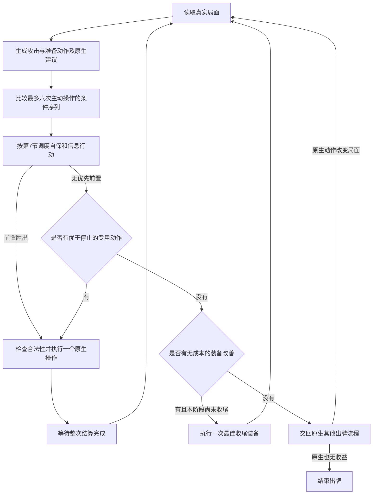

# 剑华 AI 方案 v2：白板敌方与回收连击

日期：2026-10-13。状态：已按新版 noname-design-wujiang-ai 重检，经一轮独立审查后修订。本轮仅更新方案与审查记录，不代表已经实现或通过实机测试。

本方案替代 v1 的决策设计。当前只设计，不改游戏代码。敌方按没有武将技能处理，仍保留血量、手牌、闪、桃、装备、距离、酒和属性连环等基本卡牌规则。友方不预支武将技能补偿。实现时始终遵守引擎真实合法性，不删除或屏蔽其他武将技能。

目标是在当前资源下选择值得执行的攻击顺序，同时保留有价值的后续资源。普通杀、全部武器、两种灵刃和有明确后续收益的同名换装共同竞争。没有“必须先普通杀”“必须先降费”“只支持四种武器”的门槛。

## 1. 必须保持的机制事实

- 在自己的出牌阶段主动使用武器并成功装备，本回合该名称首次满足条件时，追加一张不计次数的杀。目标按新装备计算；直接放入装备区不等于主动使用武器。
- 追加杀有合法目标时必须使用。横刹把射程内全部合法角色加入目标，普通杀也受横刹影响。
- 每点实际伤害事件的 `damage.num` 增加 3 凝。被闪或取消的伤害不增加凝；护甲吸收导致没有净掉血仍可能产生凝，不能把体力损失当作伤害值。
- 换装先处理旧装备。凝足够时锁定支付当前费用并回收旧材料，成功回收后费用减 1，最低 0。不足时不能借用接下来的伤害支付。
- 灵刃材料回手后恢复实体杀。真实武器回手不占手牌上限。
- 同名武器重复装备不再追加杀，但仍可能回收材料、换射程或改变普通杀效果。
- 凝跨回合保留，费用下一回合恢复 6。首次装备名称记录按回合重置。
- 首次装备即消耗该名称的本回合首次机会。没有追加杀目标或当时不能使用杀，也不能假设以后重装还能追加杀。同一回合的额外出牌阶段共用该记录。
- 心流不限定伤害牌名，锦囊伤害、属性传导和以自己为来源的自伤也会产生凝。失去体力不等于造成伤害。
- 结束阶段开始时，本回合没有造成正数伤害且弃牌堆仍有杀，获得从弃牌堆顶向下找到的首张杀，无选牌窗口。它发生在弃牌阶段之后，不能用于本次出牌阶段的连招。
- 首次装备的追加杀没有实体材料、花色和颜色，只继承武器材料的属性。黑杀转灵刃后产生的无色追加杀，不会被仁王盾按黑杀取消；实体杀直接使用仍保留本身颜色。
- 擢锋监听的是以杀为来源的实际伤害，不限直接目标。属性传导到其他角色也可能夺其武器。若传到自己且擢锋仍有效，会卸下自己的擢锋并收回材料；这不是换装，不支付凝、不降回收费。不能将自伤与丢失装备效果遗漏。
- 横刹各目标按原生顺序依次结算。一个直接目标先被前一目标的连环传导伤到并解除连环，不会自动退出直接目标列表，随后仍可能再承受一次直接伤害。

### 1.1 核心收益、机会与反转条件

| 收益来源 | 机会和可重复性 | 代价与反转条件 |
| --- | --- | --- |
| 首次装备追加杀 | 每个不同名称一次，手中真实武器和两种灵刃都能主动创造 | 换装可能损失旧材料或强制支付凝；有合法目标时不能取消追加杀 |
| 伤害积凝并回收 | 每点实际伤害 3 凝，各种伤害均可；回收每成功一次降费 1 | 未命中就没有该笔凝；当前费用先付，不能借未来伤害支付 |
| 同名换装继续用材料 | 回收实体杀、已夺武器或恢复连弩，可串起多次攻击 | 本次没有免费杀，需要具体后手或非攻击收益；无收益同态轮换应退出 |
| 横刹扩大伤害 | 全部合法目标，每次杀都适用；减一马可扩大范围 | 敌友都进入，酒和属性传导也会扩大己方损失；范围大并不恒好 |
| 擢锋获取公开武器 | 杀实际伤害后发动，获得的实体材料能参与后手 | 目标没武器就没有夺牌收益；链伤害的实际受伤者也要核对 |
| 武器不占手牌上限 | 持有真实武器时持续有效，不必靠本回合打光兑现 | 不代表所有武器都应该立刻装备；灵刃回收成实体杀后重新占手牌上限 |
| 无伤害时结束拾杀 | 每个自己的结束阶段至多一次，必须届时弃牌堆有杀 | 有伤害即失去资格；只补未来资源，不阻止更有收益的攻击 |

比较序列时同时检查立即伤害、当回合可用资源与回合结束保留资源。每条重要玩法都要配一个收益成立局面及条件变化后的反转局面，见第 9 节。

## 2. 决策状态

只记录会改变合法动作、收益或资源的事实。

| 状态 | 内容 |
| --- | --- |
| 自己的牌 | 实体 ID、牌名、花色、属性、当前归属；虚拟武器与材料的对应关系 |
| 武器 | 当前武器、射程、手中所有真实武器、本回合已触发过的名称 |
| 资源 | 整数凝 N、当前回收费 C、普通杀已使用次数、酒状态、本回合是否造成正数伤害 |
| 场面 | 敌友关系、体力、护甲数、公开装备、坐骑、距离、连环状态、手牌数量 |
| 脆弱记录 | 是否存在有效的“可出闪却未出闪”记录 |
| 执行记录 | 当前阶段实际到达过的状态，以及具体状态中失败过的动作 |
| 结束资源 | 当前公开弃牌堆是否有杀、正常手牌上限及不占上限的真实武器 |

敌方隐藏手牌只使用数量，不读取其名称。随机摸牌只能预测得到一张未知牌，不能把它预先当杀或武器。公开夺到的武器可以按确切牌继续规划。

## 3. 脆弱判据及用途

沿用殷华设计，满足任一条件即为脆弱。

1. 当前手牌数为 0 或 1。
2. 最近有合法出闪机会却没有出闪，之后没有获得新手牌。

直击、禁止响应、未出现合法出闪窗口，不产生第二类记录。获得新手牌立即清除第二类记录，0/1 手牌条件则重新实时计算。一次未出闪不是确定无闪。

脆弱只影响命中倾向和连击收益，不决定是否允许攻击。收益相近时，优先用脆弱敌人启动凝；脆弱且有武器的敌人提高擢锋的收益；低血脆弱敌人提高集中攻击的收益。防具和属性效果先计算，不能用脆弱覆盖防伤。

初版使用下列排序权重。数字是可调启发式，不是统计得到的真实概率。

| 情况 | 命中分支权重 |
| --- | ---: |
| 明确不能响应，且没有其他公开响应来源 | 1 |
| 零手牌，且没有其他公开响应来源 | 1 |
| 有有效未出闪记录 | 0.85 |
| 一张手牌 | 0.75 |
| 其他情况 | 0.55 |

公开防具和卡牌规则先修正命中或伤害。命中与未命中必须生成两个不同的整数状态，不能用“预计获得 1.8 凝”去支付费用。未命中消耗的公开手牌数量按响应规则更新。实际新信息到来后重新计算。

## 4. 动作候选

每次规划都生成以下动作，不按表格顺序硬选第一项。

| 动作 | 生成条件 | 必须计入的后果 |
| --- | --- | --- |
| 普通杀 | 当前确实可使用该实体杀或合法转化杀 | 普通杀次数、武器效果、全部实际目标、消耗材料 |
| 装备真实武器 | 手里存在合法武器牌 | 新射程、首次追加杀、锁定回收费用或旧材料损失 |
| 杀转擢锋 | 手中实体杀可合法转化 | 材料占用、属性、命中后的公开夺武器与凝 |
| 杀转横刹 | 手中实体杀可合法转化 | 全体目标和连环传导，不只计算选中的敌人 |
| 同名再装备 | 实际装备动作合法 | 不凭空增加追加杀；检查是否解锁后续攻击或有价值的收尾装备 |
| 卡牌配合 | 当前有合法酒、拆顺、丈八或其他原生行动 | 实际材料、次数和明确后续收益，不编造未来抽到的牌 |
| 停止专用规划 | 总是存在 | 保留当前资源，将控制交回原生其他出牌流程 |

所有合法武器先获得基础评价，包含射程、首次追加杀、回收和旧材料损失。已知特效再增减收益。纯额外收益没有精确估值时可暂记零；若未知效果会改变合法性、强制目标、伤害或存亡，必须先核实，不能当成无效果。缺口记录到具体效果，不删除整类武器或所有换装。真实合法性始终由引擎确认。

## 5. 规划与执行状态机



以下是扩展搜索时重点检查的打法，不是互斥的阶段或准入条件。

| 局面 | 必须比较的路线 |
| --- | --- |
| 凝不足以回收 | 首次装备或普通杀取得伤害，与直接牺牲旧材料换装比较 |
| 杀可以投入并收回 | 两种灵刃、真实武器与普通杀的不同顺序 |
| 有连弩和多张杀 | 保留连弩连续杀，与换装追加杀、回收杀的整段收益比较 |
| 敌人有公开武器 | 擢锋命中后夺武器，再将该武器作为新的攻击和回收资源 |
| 装备中压着实体杀 | 已用过名称的武器换装，取回杀后普通使用或转另一形态 |
| 横刹有利 | 完整多目标攻击，与集中攻击比较；后续普通杀也算友伤 |
| 横刹后续不利 | 用已触发过的单体武器换掉横刹，再精准使用回收的杀 |
| 没有值得继续的攻击 | 保留资源，或进行一次有明确装备收益的收尾，然后交回原生 |

### 5.1 有限搜索

采用六次主动操作的前瞻。装备及其强制追加杀算一次操作；响应、伤害、回收和夺武器是该操作的结算。六步覆盖已验证的五步回收连击；更长的打法依靠实际结算后继续规划，不声称得到全回合全局最优解。

每个合法根动作先完成一次直接评价，不能因为遍历顺序而漏掉后面的武器。只有每个目标仅有命中或实体闪两个结果时才有 `2^目标数` 种组合。八卦判定、雌雄弃牌或摸牌、贯石斧追伤和属性传导都可能产生额外状态，不能宣称 2v2 最多 8 种。

按原生事件顺序展开一次操作，再合并全部决策相关状态相同的结果。闪的来源、手牌是否减少、脆弱记录、连环解除、酒消耗、凝与武器归属不同，就不能合并。八卦判定使用合法公开分布；无可靠分布时使用标明假设的红黑各半启发式，不能偷看牌堆。对手可主动选择的公开分支先取对己方较差的合法结果，实际选完立即重判。直接评价未完成的根不能拿一半的分支分数参与比较，也不能被标记为永久不可用。

在深入预算之前，每根预留最多六步、每步只取一个可行结果的回收续招见证空间。这是候选保留用途，不给未完整评价的路线计分。随后轮询分配深入搜索预算，每根最多扩展 256 个状态，全局深入扩展最多 8192 个，命中/未命中机会结果也计入状态数量。上限是首版工作量参数，后续实现需测开销，不作为“动作不可用”的规则。

每个根动作至少保留一条回收后继续攻击的候选路径。涉及“取回杀→出杀”“取回武器→另一形态→取回杀”的可行路径优先补齐到收益兑现，避免即时没有伤害就被截掉。新武器名称和不同灵刃形态不互相作为重复动作删除。

命中和未命中的结果分别继续选择最好的合法后手。装备目标、实际追加杀目标、材料和后手见证都应能输出供检查。预算不足以完整评估一个新动作的所有结果时，不展开这个新动作，保留该节点的停止和已完整评价动作。预算用完只停止继续展望，未展开后手按停止评价，不虚构收益，也不把所有根动作清空。合法性及友伤上界检查不能因预算用完而省略。

### 5.2 明确比较方法

先执行合法性和友方存亡检查，再给完整条件序列评分。初始权重如下，后续只根据实战证据调整。

| 变化 | 分值 |
| --- | ---: |
| 敌方有效体力损失 1 点 | +4，最多计到其当前体力 |
| 首次把一个敌人压到濒死 | 另 +6，只是争取减员，不宣称已击杀 |
| 友方体力损失 1 点 | -6 |
| 友方由 2 血以上下降到 1 血 | 另 -4 |
| 敌方护甲损失 1 点 | +2，不再把已吸收的部分计成体力损失 |
| 己方护甲损失 1 点 | -3，含剑华本人 |
| 敌方实际消耗或失去一张牌 | +1；响应、拆除与夺牌的失牌只登记一次 |
| 队友实际消耗或失去一张牌 | -1；自己的失牌只从 R 扣除 |
| 实体杀的保留价值 | 1.5 |
| 实体闪的保留价值 | 2 |
| 实体桃的保留价值 | 3；自己 2 血以下时为 5 |
| 真实武器或其他牌的保留价值 | 1 |
| 凝的保留价值 | 每点 0.1，最多计前 12 点 |

定义资源值 `R(s)` 为自己拥有的实体牌价值加凝的保留价值。一张实体牌只计一次，转为虚拟装备材料时仍算拥有，不再给虚拟外壳重复计价。桃的保留单价按本次规划根状态的自己血量固定，不能通过自己受伤给原有桃集体涨价。凝的上限只作用于保留估值，不限制实际储存和支付。回收能力的主要价值来自确实能接上的后手，不靠无限提高凝的分值。

已知的装备拆除和其他卡牌收益必须按同一资源口径登记一次，不能在“夺武器奖励”和最终资源中重复计同一收益。未知摸牌暂按 1 分记录，后续牌型等真实摸到后再规划。自己回血每点 +4，可纳入原生动作比较；原生 AI 分数不直接与这套数值相加。

友方体力损失包括剑华本人。自己通过连环受到伤害时，同样扣体力分和降至 1 血的附加分；所得凝照规则记入 R，不能只记收益。预测有己方角色进入濒死时按第 5.3 节处理。

结束拾杀资格值 F 为 1.5，仅当当前本回合未造成伤害且公开弃牌堆有杀时成立，否则为 0。这是对结束时仍能取得该牌的资源估值，不把它加入当前手牌。实际造成伤害、弃牌堆变化时重新计算；模拟完整操作也需更新用牌进入弃牌堆的事实。每次完整操作结果的即时收益为 `r = 本次战斗分 + R(结果状态) - R(操作前状态) + F(结果状态) - F(操作前状态) + 本次其他已知卡牌收益`。同一收益只能登记在其中一个项目里。

因此停止仍为相对当前资源的 0；攻击失去拾杀资格须计机会成本，被闪后仍能拾杀则保留该价值。已造成过伤害时，不再重复扣这项成本。并非所有牌都能确定进入弃牌堆，例如灵刃材料仍在装备区，不得凭空创造拾杀资格。敌方消耗实体闪有失牌成本，八卦生成闪则没有，不能把所有未命中都当作完全无收益。

使用以下递归评分，而不是先贪心选后手、再另算全局最差路径。

```text
结果值(o) = r(s, a, o) + 0.9 × V(结果状态, 剩余深度 - 1)
Q(s, a) = 0.8 × Σ[结果权重(o) × 结果值(o)]
          + 0.2 × min[仍可能发生的结果值(o)]
V(s, 深度) = max(0, 所有已完整评价合法动作的 Q)
深度为 0 或后手未展开时，V = 0。
```

停止为 0，折扣倾向于更早兑现收益。风险惩罚在每个决策层重复生效，这与整条路径只惩罚一次最差结果不同。不存在正分专用动作时检查无成本收尾，再交回原生，而不是强迫结束回合。

同分按友方损失少、不可恢复材料损失少、操作少的顺序比较，最后使用稳定的牌 ID 排序。没有“先普通杀”或“先灵刃”的固定平局优势。

### 5.3 友伤与濒死

完整计算横刹所有目标及属性连环，累计同一条路线里的己方损失，包括剑华本人。任何确实可能发生的分支会因某个主动动作把自己或队友打入濒死，则排除该动作；不预支桃或队友技能救援。保留不进行该后续动作的路线，不因此删除所有起手。属性多目标按真实结算顺序逐次传播和解除连环，不能独立对每个目标重复扩散同一批连环伤害。

其余友伤不一票否决。包含友伤后的路线必须胜过最好的无友伤路线，包括停止。三个敌人一个健康队友、两个敌人两个健康队友且能争取减员，都有可能胜出，取决于命中倾向和实际后续资源。

预测敌人濒死时，给予一次争取减员奖励，但不提前改变死亡后的座次和距离。对当前攻击尚未结算的目标仍检查己方损失上界，后续主动操作暂停预测，等真实救援或死亡结算完成再规划。不读取暗桃，不预判必然无人救援。若已经进入不能取消的强制选目标窗口，只能选合法目标中己方损失最小者并完成结算；主动动作的风险筛选不能在这里造成无目标卡死。

## 6. 不攻击的换装何时值得做

同名换装仍进入候选，但作为连击的一步执行前必须持有以下至少一种收益见证。

1. 回收指定实体杀，能在六步内用于一项具体合法攻击。
2. 回收指定武器，能继续产生尚未用过名称的追加杀。
3. 恢复连弩，释放目前实际持有或可回收的普通杀。
4. 改变射程或移除横刹，使指定攻击合法或明显减少友伤。
这些见证按包含后手的整段分数比较。仅仅降费、回收次数变大、想象下一次会摸到杀，都不构成收益见证。降费只有在同一前瞻内确实解锁攻击时才有价值。

纯收尾是独立的小分支，不要求通过攻击分数门槛。只有没有正分连击、不会损失实体材料、不会支付凝、没有不利强制追加杀，且原生装备评价严格提高时，才选择其中原生装备评价最高的一次装备。每出牌阶段最多执行一次专用收尾，不把原生分与连击分直接相加。有损失或费用的装备不能借此绕过成本比较，只能靠明确后手收益进入连击，或交原生自行处理。

## 7. 原生卡牌与武器特效

### 7.1 每次行动前都进行调度

桃、酒、摸牌牌、拆顺、坐骑、护甲与伤害锦囊不必等待专用连击耗尽。普通杀、灵刃、真实武器由专用规划统一管理，不同时作为“其他原生牌”重复选择。每次读取真实局面后，按以下顺序作一次选择。

1. 自己不高于 2 血且有合法、确实能回复的桃，先正常使用一张并重判。濒死救援继续使用原生响应。
2. 生成全部专用候选，同时取得原生其他行动建议。酒、拆顺的公开牌目标、改变距离的坐骑、连环变更和其他明确改变连击条件的准备动作，必须进入同一 Q 比较，既允许攻击后手，也允许该动作自身有正收益后停止。攻击资源被拆掉、酒被下一张强制杀消耗、移除坐骑导致某目标进出范围，都按操作后的真实状态展开。原生建议不得以敌方暗牌身份为输入；需要暗牌的估值仅用公开数量。评分比较不能触发实质出牌。
3. 专用首选若不伤及己方，且第一步按公开信息足以把一个敌人压入濒死，可先执行该步。公开信息必须足以排除闪和防伤，不能把脆弱或 0.85 权重当作必中；也不宣称一定击杀。
4. 否则，原生若建议正收益的纯摸牌或获取信息行动，可先执行一次再重判。此例外只适用于不改变现有装备、距离、连环、伤害状态、不消耗已选路线材料且不送给对手牌的动作，例如无中生有或正收益铁索重铸。酒、拆顺、五谷丰登、伤害锦囊和换装备都不属于此例外。未知牌只记数量和 1 分基础价值，不能预支它的牌型。
5. 其余已明确建模的攻击与准备动作按同一 Q 取正分最高者，原生默认 order 不得覆盖比较。尚未纳入联合搜索的正常伤害锦囊和其他原生牌保留原生入口，专用动作的调度 order 取屏蔽自身覆盖后的普通杀 order，不用固定极高值压住其他牌。先执行哪一张由原生正常顺序决定，实际伤害和新信息出现后重判。该部分仅保留原生基线，不宣称已优化其跨牌连招；若实际暴露确定劣序，则将相应状态转移补入联合比较。
6. 无正分专用动作时，仍评价原生其他正收益动作以及第 6 节的纯装备回退。真正停止须三者均无可执行收益。不能把所有真实武器清零后声称已交还原生。

这是一条明确的初版调度启发式，不保证所有卡牌的全局最优排序。原生操作完成后重判，不能锁定“原生优先”状态。每步必须消耗真实牌或改变局面，无收益重铸或反复换装仍受完整状态防循环约束。原生动作同样不能绕过公开己方濒死风险检查。准备动作不得仅因自身不伤人就通过，例如酒必须计入下一张强制或计划内杀的全体伤害。

有明确攻击收益的酒、减一马、拆除公开防具或解除己方连环，可以作为连击的前置一起比较，占用一次搜索操作。伤害锦囊造成的实际伤害也更新凝；没有该次真实伤害，不能提前回收。对于尚未展开的锦囊响应，不预支其凝去给后续路线加分，先让原生行动结算后重判。未知摸牌只按未知牌计值，不能预先得到指定杀或武器。

### 7.2 武器与公开响应的分支

- 雌雄剑只按真实性别条件触发。对手选择弃牌或令自己摸牌后立即重新观察，不预支抽到的具体牌。
- 丈八枚举两张合法材料形成普通杀，并计入材料成本与普通杀次数。转化杀不等于先得到一张可再用于灵刃的实体杀。
- 贯石斧在杀被闪后比较弃两牌强制造成伤害的收益，包括能否补足下一次回收费用，不能无条件丢桃闪或尚有攻击价值的武器。
- 青龙偃月刀追杀发生在当前杀被闪后的响应窗口，允许对原目标再用不计次数的杀。只生成该窗口允许的材料和目标，比较追杀与放弃；不能因普通杀次数已用完而拒绝。每次追杀消耗真实材料，重新读取对方出闪后的手牌数，不无限沿用起手快照。
- 寒冰剑比较取消伤害并弃牌，与正常伤害两项。取消分支不获得该次凝、不触发该次链伤；隐藏手牌按数量估值，不能读取对手牌名来选更贵的暗牌。公开装备按实际移除后状态比较。
- 麒麟弓拆马后按实际距离重规划。青釭剑按破防后的伤害评价。连弩只改变普通杀次数，追加杀本来就不计次数。
- 酒由下一张实际使用的杀消耗，追加杀也会消耗；被闪也不保留给下一刀。横刹的一张多目标杀使用同一酒增伤，分别经过各目标防具结算，不能只给选中的敌人加伤而漏掉队友。
- 八卦生成闪不减少手牌，不因其成功就清掉或建立“手中无闪”的记录。八卦失败后仍要看是否实际有合法出闪窗口；判定结果本身不等于无闪。
- 火杀、雷杀、普通杀分别比较材料用途。追加杀继承属性但不继承颜色，藤甲与仁王盾的判断不能照搬材料杀。
- 擢锋的链伤夺武器逐次结算。若自身链伤使擢锋卸下，后续状态必须变为空武器并回收真实材料，不能继续假设持有擢锋、凭空消耗凝或重复取得同一材料。
- 其他武器至少保留已核实的基本换装与追加杀评价。尚未调查的强制效果标为机制缺口；已确认的可选纯额外收益可保守估值。

普通出牌规划只管理出牌窗口。杀、闪、桃、无懈等原生响应继续按各窗口规则执行，不能等待外层整张牌结算完才响应。贯石斧、青龙追杀、寒冰剑等嵌套选择只在该窗口内比较合法选项与放弃，使用当时的真实状态。外层操作全部结算后，才恢复下一次主动出牌规划。这样既不会在未结束的响应中擅自发动灵刃，也不会因外层等待而卡死。

### 7.3 收尾与弃牌

真实武器不占手牌上限。普通弃牌阶段不为了减少超限张数而弃这些武器，因为弃掉它们并不能满足所需的有效弃牌数。确有其他强制弃牌或武器是发动成本时，再按该操作合法性比较。

必须弃计入上限的手牌时，先按第 5.2 节保留价值由低到高选择，同分交原生保留价值与稳定 ID。当前不需保留的酒或无收益锦囊可先弃，桃、闪和杀按明确价格比较。此价格只是首版基线，不宣称精确预测下回合。

六步前瞻仍不计算全轮防守。没有本回合攻击后手的有成本换装，交回原生时必须保留真实武器的可执行入口，不能把评分清零。回收手杀用于回合外响应、弃牌压力与末尾装备强弱的完整跨回合估值列为后续策略范围；不能在此声称已经达到全回合最优。

## 8. 防空转与失败回退

完整状态签名包含实体牌归属和材料、有效回收费、凝、已用武器名称、普通杀已用次数、酒、各角色体力与护甲、公开装备、距离、连环状态、手牌数量及脆弱记录、本回合伤害标志和公开弃牌堆杀的可得性。费用已为 0 时，不把无意义增长的累计回收次数加入签名。

- 搜索路径内出现相同完整状态，截断该路径。零费用 A/B 对换不能无限延长。
- 实际执行返回本阶段已到达的同一状态，禁止重复同一换装循环，重新选择其他收益动作。
- 失败只记录“当前状态＋具体动作”。材料或局面变化后允许重新考虑，不永久封锁整类武器或整个灵刃。
- 行动失败、未命中、夺武器失败、摸牌、目标离场或距离改变，都按真实状态重新规划。
- 计算超时保留已完成评价的合法根动作；无法完成时交还原生出牌，不以继续等待或重复重算卡住游戏。

## 9. 设计验算与未来必测场景

| 场景 | 必须看到的选择或可达路线 |
| --- | --- |
| 三杀、零凝、两种形态均有安全目标 | 两种灵刃和普通杀都能被规划，不以无凝禁用换装；命中路线可以三次攻击 |
| 六凝、一杀、一武器 A、空装备 | 五步四攻路线能完整展开，第四步同名换装因回收杀而有收益 |
| 第一刀被闪 | 没有获得该刀凝，后续不足费用时不能按原计划回收 |
| 没有脆弱敌人 | 仍正常评价攻击和装备，有正分攻击可以执行 |
| 脆弱敌人与更低血但多手牌敌人 | 比较击倒机会与启动回收价值，不单按最低血排序 |
| 一名脆弱敌人有武器 | 擢锋命中后，实际夺到的武器进入后续候选 |
| 连弩与多杀 | 保留连弩多杀的路线存在；更好的换装连击也有机会胜出 |
| 三敌一友，队友健康 | 友伤路线可以与无友伤路线竞争，不自动删除横刹 |
| 两敌两友，可争取敌人减员且队友健康 | 减员机会计分，友伤按整段累计，不能仅看第一刀 |
| 后续横刹会打队友至濒死 | 该后续被否决，可换回单体武器或停止，起手不被全局封死 |
| 零费同名轮换，没有新增攻击或装备价值 | 相同状态被截断，不无限交换 |
| 截图的五武器、一杀、一闪、两桃 | 五种真实武器全部入候选；能够看到其各自被选或未选的具体收益原因 |
| 对手开始濒死或获得新手牌 | 不假设已死亡或仍然无闪，重新观察实际结算 |
| 没有值得执行的剑华动作，但有正收益摸牌或装备牌 | 原生出牌继续，不提前结束出牌阶段 |

本轮补充以下相邻局面，用于实现时的行为回归。这里只做源码推导与纸面验算。

| 收益成立局面 | 只改变一个关键条件后的检查 |
| --- | --- |
| 有无中生有和可用武器，但没有公开确定的一步濒死路线 | 无中优先取得真实新信息；若有无己方伤害的确定一步压濒死路线，可先攻击 |
| 正收益伤害锦囊先造成伤害，凝由 3 增至 6 | 若锦囊被响应而没有伤害，仍为 3，不能借此回收 |
| 本回合无伤害且弃牌堆有杀 | 成功伤害扣除一次拾杀资格值；若此前已造成伤害，不重复扣除 |
| 被实体闪抵消 | 对比八卦生成闪，同样未命中，但前者减少手牌、后者不减少，不可合并 |
| 黑色实体杀对仁王盾无效 | 同一张黑杀转首次灵刃，追加杀无色，不能照搬黑杀无效结论 |
| 饮酒后换装触发横刹追加杀 | 所有目标都计算酒伤；若用单体武器，队友不再承受横刹追加伤害 |
| 己方 1 血且与敌人连环，有火杀 | 濒死风险排除该属性路线；非属性杀或先解除己方连环仍能入选 |
| 剑华与敌人连环且持擢锋，属性杀会传到自己 | 逐次加入自伤成本、凝和自身材料回收；未连环时不凭空卸下擢锋 |
| 2 血且有桃 | 使用一张后重判；满血或桃不合法时必须退出该分支 |
| 多把真实武器加超限普通手牌 | 弃牌数按普通手牌计算；灵刃材料回成实体杀后重新计入上限 |
| 已进入强制追加杀窗口，但当前只剩友方合法目标 | 完成合法最小损失选择；主动规划时同样局面应避免触发，不得在强制窗口拒绝所有目标 |
| 已用名称的擢锋、零凝、手杀和过河；敌人 4 血空手且装备连弩 | 先杀夺弩再装弩的两攻路线应胜过先过河拆弩再杀；把敌人装备改为阻止杀的公开防具后，先拆再杀能进入竞争 |
| 横刹加减一马，三名 4 血空手敌人与一名 2 血空手队友均在范围；已有伤害，两形态名称已用，手酒和杀，无备用武器，零凝 | 普通杀路线正分但酒后杀会令队友濒死，应直接杀；把队友改为足以安全承受酒杀的血量后，酒路线可重新比较 |
| 敌人有 1 护甲，受到 1 点杀伤 | 护甲减少、体力不变、剑华加 3 凝且失去无伤拾杀资格；若伤害事件被取消则都不计 |
| 横刹的后位直接目标先吃到传导 | 已解除连环仍保留后续直接杀结算；后位出闪只避掉直接部分，不能抹去已受传导 |
| 存在只限制闪的全局 mod | 核对具体装备或杀动作的合法性，不因全局 mod 存在就封锁所有换装 |
| 普通杀次数已用完，青龙追杀窗口开启且仍有杀 | 可评价该次不计次数追杀；离开窗口后不能把这个权限用于随意普通出杀 |
| 寒冰剑选择取消即将造成的伤害 | 只计弃牌收益，不得同时取得伤害、凝或属性传导收益 |

五步例子的命中路线为 `6 → 9 → 6 → 4 → 0 → 3` 凝。该路线是合法性验算，不表示任何实际局面都应强行追求四刀。命中失败、射程、友伤和下一轮资源都会改变实际首选。

## 10. 设计选择与边界

以候选 B 的条件序列搜索为主，采用候选 A 的局势打法表帮助扩展和解释。拒绝固定“启动→降费→循环”的单向阶段，因为同名回收、连弩、夺武器和未命中会跨越阶段。采用每根直接评价和公平扩展，避免全局剪枝让某种武器永远没机会。

六步深度、调度规则和启发式权重限制了远期精度。敌方特殊技能不在本轮策略建模范围。无独立实机证据前，不能将此方案称为已完成的 AI；后续实现应先用本节场景检查行为，再扩大策略范围。

## 11. 本轮机制证据

本地源码基线为 `nihilphile武将包/module/jianhua.js`，SHA256 为 `1B7FD3CBE67FA2837F1646A1240375DCE1D6DB4A1A5DC853FA20E6B4D2CDA68C`。以下行号均指本次读取的文件，不使用旧 AI 的限制作为机制规则。

| 事实 | 源码位置 |
| --- | --- |
| 主动装备、记录名称、无材料追加杀与属性 | jianhua.js 833–907 |
| 无伤害结束拾杀、真实武器不计上限 | jianhua.js 902–912、804–806 |
| 各种 source damageEnd 积凝、成功回收后付费降费 | jianhua.js 1038–1046、1060–1150 |
| 擢锋不排除链伤或自己；横刹增加全部合法目标 | jianhua.js 1176–1224 |
| 连环保留原伤害的 card 和 source | 目标引擎 noname/library/skill.js 1955–2011 |
| 无材料虚拟牌无色、仁王盾只取消黑色杀 | noname/library/element/vcard.js 53–68；card/standard.js 3566–3589 |
| 酒修改整张杀的 baseDamage、使用后移除 | card/extra.js 1108–1175 |
| 八卦虚拟闪与判定 | card/standard.js 4139–4210 |
| 青龙嵌套出杀不计次数；寒冰取消伤害后弃牌 | card/standard.js 3807–3843、3478–3564 |

目标引擎根目录为 `F:/AI_project/nameless_game/_task_runs/jianhua-ai-20261011/game/resources/app`。这些是静态源码证据，本轮没有启动客户端。擢锋链伤自回收的完整界面表现与复杂多目标顺序仍应在实现阶段定向实测。
