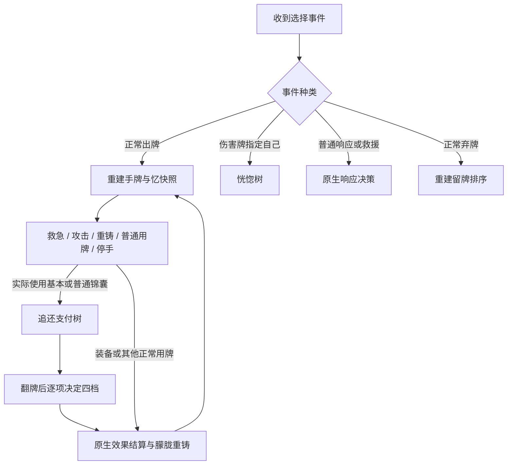

# 无忧 AI 决策树工程初案 v1

2026-10-11。依据当前 `module/wuyou.js` 的 v2.4 机制。本文已纳入实现前独立对抗审查修订，参数是首版默认值，尚无 AI 实战校准。审查记录见同目录《无忧_AI对抗审查_v1.md》。

目标是让每个选择窗口都能输出明确的动作、目标、支付花色和原因。采用事件驱动的状态机，每次结算后重算。普通用牌保留引擎已有能力，新增逻辑负责朦胧的整组手牌成本、恍惚防御、追还支付及四档选项。

方案已实现首版并合入 `nihilphile武将包/module/wuyou.js`。独立对抗式设计审查的两项阻断已修订，独立代码复核未发现已证实阻断；19项机制检查、15项AI行为与接线检查通过。正式禁选状态及发布包未变。实现范围与保守边界见 `artifacts/wuyou-ai-v1/implementation-handoff.md`；实机状态以验收记录为准，不由单测推定。

## 1. 从殷华、落绯继承什么

| 已有实现 | 本方案采用的方式 | 无忧需要调整的地方 |
| --- | --- | --- |
| 殷华 `xyDecideInitialRoute` 先判硬条件，再决定 ATTACK、DANEN 或 HOLD | 每棵树从上到下首个命中分支返回，返回原因码 | 不复制首杀放弃丹恩的回合锁定；无忧随机重铸后必须重新规划 |
| 殷华 `xyChooseCardsToKeep` 对具体牌分档，计算哪些牌实际留得住 | 留牌计划返回实体牌 ID；朦胧检查是否会洗掉这些牌 | 不能只给一张桃高分；同花色其他牌被使用也可能洗掉桃 |
| 落绯 `luofeiDecideYinchaoSpend` 为流生预留资源 | 追还扣费前检查恍惚的防御库存 | 防御门槛是同花色 2 枚，不能照抄“始终留 1 枚” |
| 落绯逐张红杀重算目标，原始收益非正就不加奖励 | 原牌效果、目标、取牌、不可响应和增次分别检查 | 追还翻牌前只有概率，翻牌后才使用真实匹配数 |
| 两者评分与实际结算分开 | 纯决策读取快照；真实事件负责失牌、支付和状态推进 | 不在 `aiOrder`、`aiUseful` 或 `effect` 中增加忆、扣忆、假装已经重铸 |

殷华旧文档中的丹恩回血对象、手牌规划“尚未落地”的状态，与当前源码已有差异。本文借鉴当前源码结构，不沿用旧技能描述。

## 2. 规则事实与时间顺序

1. 朦胧在自己的出牌阶段，使用恰一张实体手牌材料后触发。使用装备也可触发。无素材、多素材和装备区素材不算。
2. 使用牌的有效花色在 `useCard1` 记录。整张牌的 `useCardAfter` 才重铸当时所有同花色、允许重铸的手牌。不是选几张重铸，也不是重复洗新摸到的牌。
3. 真正使用的素材不加忆。响应打出、重铸、被获得、弃置、旧装备替换等实际非使用失牌按实体花色加忆。响应的底层 loss 也可能标记为 `use`，不能仅凭该字段判断。
4. 追还在 `useCard2` 支付已有忆。不能拿本张牌结束后预计重铸所得的忆支付。装备不触发追还，普通锦囊和基本牌可以；延时锦囊不可以。
5. 每种支付花色最多扣 1 枚。翻 k 张牌，计算支付花色与翻牌花色交集的种数 m，不是匹配牌张数。
6. m 达到 1、2、3、4 时，依次可选加一名目标、逐目标逐次随机取手牌、不可响应、额外结算。四项分别可取消，支付不退款。
7. 取牌接受后不能逐目标反悔，也不能挑敌方的具体手牌。额外目标继承取牌效果，额外结算也可能再取牌。
8. 恍惚清空来牌同花色的全部忆。只有原库存至少 2 枚才将自己排除。只有 1 枚时发动会白白清空。

```text
选择用牌
  → 材料失去，真正使用素材不加忆
  → useCard1 记录朦胧花色
  → useCard2 决定追还支付，翻牌，决定四档
  → 各目标各次效果，可能获得目标手牌
  → useCardAfter 重铸此时所有符合条件的同花色手牌
  → 实际重铸产生忆，摸等量新牌
  → 回到选择用牌，全部重算
```

取来的牌、无中生有摸到的牌若与本次记录花色相同，也可能在末尾被重铸。出牌前不预测其牌面，不把“获得一张好牌”计为确定收益。

## 3. 状态与输入

战术状态每次从快照推导，不长期锁定为进攻或防守。

| 字段 | 明确定义与来源 |
| --- | --- |
| `memory[suit]` | 只读 `player.storage.nihil_liulian`，缺失按 0；评分不调用会初始化存储的 `memories()` |
| `ownHand` | 本人的实体手牌、有效花色、牌名、使用和响应合法性 |
| `publicPlayers` | 存活、体力、公开手牌数、装备、判定、标记、距离、可观察技能和引擎态度 |
| `danger` | 自己体力 ≤1；或体力 ≤2 且没有合法可用的闪、桃、无懈中的任何一张 |
| `criticalCards` | 按下面的保牌规则选出的至多两张具体牌 |
| `reserve[suit]` | danger 时，凡该色库存 ≥2，最低保留 2；其他花色为 0 |
| `pendingUse` | 当前真实 useCard、素材、目标、已排除目标、已接受追还选项与实际匹配数 |
| `decision` | 动作、目标 ID、支付花色数组、选项布尔值、原因码，以及所用快照版本 |

自身单独识别。其余角色按 `get.attitude` 的正负判友敌，0 为中立。不读取隐藏身份，不调用敌方 `getCards('h')` 获取牌面，不读取真实牌堆顶。

首版不新增“无闪记忆”。目标手牌 ≤1 只作脆弱加分，不能视为确定没有闪。以后若接入殷华、落绯的公开响应记录，必须同样排除直击造成的未响应，并在目标摸牌后失效。

决策状态如下。



## 4. 出牌树，先判断整组损失

### 4.1 确定保留牌

优先保留一张桃；没有桃且体力 ≤1 时，改保留一张能自救的酒。再保留一张合法闪；没有闪时改留一张无懈。最多两张。同类多张按静态基础牌值、原手牌顺序选定。其余副本按普通资源评价。

这两张牌是高保留成本的对象，仍可由自己正常使用或响应。只有危险状态下唯一自救牌或唯一有效响应牌，才对普通攻击保留硬保护；危险状态有其他同类可用牌时不把每个副本都硬锁。自己受伤且桃可实际回血时，回血动作始终能进入比较；1血紧急回血直接优先，不为保护另一张同花色牌而拒绝回血。健康状态的保护牌采用有限成本，不能无限压过击杀或资源周转收益。

对每个原生合法候选动作 a，计算 `recastNow(a)`，即假设材料已使用，当前剩余手牌中与有效使用花色相同且可重铸的牌。只有符合朦胧触发条件的动作才有该集合。对于未知转化规则，不自行猜测材料或花色。

### 4.2 顶层优先级

| 顺序 | 条件 | 操作 |
| --- | --- | --- |
| 1 | 自己体力 ≤1，能合法用桃回血 | 使用桃，记 `EMERGENCY_HEAL`。多个桃优先选附带重铸损失最小的一张 |
| 2 | 自己受伤且能合法用桃回血，或存在不触碰危险状态唯一保命牌的正收益动作 | 进入下述净收益比较与候选排序 |
| 3 | 普通攻击会重铸危险状态的唯一自救或有效响应牌 | 暂缓该动作，记 `PROTECT_SUIT_GROUP`；不以预计摸到新防御牌解除限制。实际回血动作不受此否决 |
| 4 | 无上述候选，但存在合法的原生活动，不触发朦胧或成本已可判断 | 使用原生 AI 的正收益动作 |
| 5 | 所有可理解候选都无正收益，或只剩被保护花色阻断的动作 | 停止本次出牌选择，记 `HOLD` |

正常救援、濒死用牌、别人回合响应不套本表，保留原生行为。首版不为刷忆新增主动无收益用牌，也不故意吃伤害赚响应机会。

### 4.3 候选排序

先排除不合法、主动伤害友方、原牌收益非正的动作。然后按以下优先级排序。

1. 可立即回复自身体力或解除自身负面判定的动作。
2. 正收益攻击中，目标体力 ≤ 本次可确认的单次伤害下界，且没有已知阻断的动作。它是击杀机会，不预言敌方救援或隐藏响应。
3. 重铸净变化为正，并使某色忆从 0/1 增至至少 2 的动作。
4. 其他正收益动作，按统一净分排序。

同优先级先比较净分，再比较原生顺序，最后按实体牌 ID 和目标座次稳定排序。保留普通目标合法性检查。不能通过 target filter 禁掉真人选项。

用于首版重铸比较的独立尺度如下。这些是待调参数，不是引擎原生分值。

| 当前剩余牌类别 | 失去该牌的成本 | 重铸替代收益 |
| --- | ---: | ---: |
| 危险状态唯一保命牌 | 普通攻击直接否决；实际回血可进入比较 | 不靠预计摸牌解除硬保护 |
| 其余保护牌 | 3 | 1 |
| 当下有正收益合法用法的普通牌 | 1，仅计持有价值，不再加其用牌收益 | 1 |
| 暂时无正收益用法，但非重复废余牌 | 1 | 1 |
| 停手时按当前手牌上限必弃的牌、同名多余装备、无用途低档牌 | 0.25 | 1 |

每重铸一张牌额外计未来忆价值 0.2 分；若本组重铸使该花色达到 2 枚，额外加 0.8 分，整组最多加一次。新摸牌的牌名和花色均未知，不再向后搜索。

统一净分为 `原牌效果分 + Σ(1 − 被重铸牌成本) + 未来忆价值`。原牌效果分使用第 6.3 节同一尺度，原生 effect 只用于正负筛选及同分排序，不把原生分值直接与这些参数相加。未知牌或装备经原生判断确有正收益时，原牌效果分保守记 1；复杂动作的同花色成本仍可判断时照常扣除。除紧急回血外，统一净分必须大于 0 才进入候选。出牌排序不提前计追还赌博收益，真实 useCard2 再决定是否支付。

成本计算先调用同一份 `wyPlanKeep`，确定停止用牌时能保留和必须弃掉的实体牌。非硬保护牌若本来必弃，优先采用 0.25 的边际成本，即使它当前存在合法正收益用法。对同色其余牌的评分是持有价值，不能再额外叠加假设每张都能独立使用的行动机会。不能把停手后的必弃损失当成零，再把重铸它们记成完整损失。

同色多张有用牌不能假定全都能依次用出。按用户确认，同一有效花色只保留当前合法动作中净收益最高的一张作为组候选，其余牌统一进入本次重铸估值。组内其他牌不再累加各自用牌收益作为损失。再在各花色组候选与停手之间比较，实际结算后重新分组。未知转化、非单实体材料和响应窗口不套实体普通牌的分组淘汰。

普通保留牌成本从最初的2修订为1，避免把其单次行动收益混入持有价值。2血同色桃闪杀，即使该色原本已有2忆，回血净分也为 `2+(1−3)+(1−1)+0.4=0.4`，因此能正常回血，无需给回血分支硬塞一个正分保底。

例：手中有红桃桃、红桃杀、黑桃装备，体力2。红桃组比较用桃与用杀，通常选直接回血；黑桃装备形成另一组候选，再比较出牌顺序。手中有梅花杀及两张无用途梅花装备，梅花忆为0且有正收益敌方目标时，梅花杀得到“重铸两张并形成防御忆”的加分。

## 5. 恍惚树

以本次来牌的实际花色、当前同花色忆数 n、自己作为目标的收益和响应能力为输入，从上到下执行。

| 顺序 | 条件 | 操作与原因 |
| --- | --- | --- |
| 1 | n <2、无花色、不属于伤害牌、自己已经被排除 | 不发动，`NO_CANCEL_VALUE` |
| 2 | 已知对自己无害，或自己承受整张牌的效果为正收益 | 不发动，`NON_HARMFUL_EFFECT` |
| 3 | 能用一张非保护牌进行确定有效的普通响应，且该响应会避开本次全部伤害 | 不发动，交给原生响应，`CHEAP_RESPONSE` |
| 4 | 来牌直击自己、要求多张响应而自己不足，或没有有效响应；且估计会令自己濒死 | 发动，`PREVENT_DYING` |
| 5 | 不满足上项，但 danger，或本次预计伤害 ≥2，或不能通过自己已有牌可靠防住 | 发动，`PREVENT_DAMAGE` |
| 6 | 自己健康、伤害仅 1，且有合法可靠响应 | 不发动，保留整组忆，`KEEP_MEMORY_USE_RESPONSE` |

“可靠响应”首版只识别标准杀、南蛮、万箭等可明确列出的响应方式，并检查禁响应和所需张数。决斗、火攻及复杂扩展牌不因手里有一张杀或闪就判为可靠。未知伤害量按 1 估计，但不声称它是保证值。

发动只清空来牌花色，不能改成花费 2 枚。库存很多也不提高本次防御强度，因此不能因“清空 5 枚太亏”而选择承受可预防的致命伤害。恍惚只排除自己，不负责解除其余目标的风险。

## 6. 追还支付树

### 6.1 固定前置检查

```text
不是基本牌或普通锦囊 / 没有忆
  → 不支付

按当前目标和可追加目标，四档都没有可接受的新增收益
  → 不支付

枚举当前有库存花色的所有非空子集，最多 15 个
  → 删除支付后低于 reserve 的子集
  → 对剩余子集计算期望净收益
  → 最大净收益 >0.25 才支付
  → 否则取消
```

不要先决定“花几个”再随便点花色。枚举对象必须是具体花色集合。例如黑桃库存 2、红桃库存 4，支付红桃 1 枚通常比打破黑桃的 2 枚防御门槛便宜。

危险状态不为随机追还拆掉已有 2 枚防御门槛。预测本次结束后能重铸补回来，不构成豁免，因为目标结算期间就可能发生反击或伤害。

### 6.2 概率模型

首版固定使用每张牌四花色各 1/4、各次独立的先验。这是估算，不是对剩余实体牌堆的精确描述。未知牌堆构成、洗牌、无花色牌都会使实际概率不同。首版忽略公开控顶信息，不读取隐藏牌堆。

| 支付不同花色数 k | m≥1 加目标 | m≥2 取手牌 | m≥3 不可响应 | m≥4 增次 |
| --- | ---: | ---: | ---: | ---: |
| 1 | 25% | 0 | 0 | 0 |
| 2 | 75% | 12.5% | 0 | 0 |
| 3 | 98.4375% | 65.625% | 9.375% | 0 |
| 4 | 100% | 98.4375% | 65.625% | 9.375% |

可枚举四花色的 k 次序列计算分布，最多 256 条。对每条序列，统计支付花色集合中有多少种出现。将 m=0..4 的结果预先缓存，回调不重复枚举翻牌。

### 6.3 成本与收益

每支付该花色一枚的基础成本如下。

| 支付前该色数量 | 成本 | 理由 |
| --- | ---: | --- |
| 1 | 0.7 | 丢掉一种支付花色 |
| 2 | 1.5 | 同时打破该色恍惚门槛 |
| ≥3 | 0.35 | 支付后仍保留恍惚门槛 |

设支付集合为 S。计算 `Score(S) = Σ P(m | S) × U(m) − Σ Cost(s)`。

`U(m)` 是实际匹配数为 m 时，可接受的选项组合的最大增量收益。原牌本来就能造成的收益不重复计算，已经付出的忆不在翻牌后再次扣分。

为避免四档重复计数，对每个 m 枚举“是否加目标及加谁、是否取牌、是否直击、是否增次”，最多 `8 × (1 + 合法追加目标数)` 个组合。每个组合重新计算最终目标集合，应用第 7 节的否决条件，再与所有选项关闭的原牌比较。不能把四个独立最高分简单相加。

首版增量分使用统一尺度：

- 对原生估值为正的敌方，新增一次有效伤害效果计 2 分。目标体力 ≤该次伤害估计且手牌 ≤1，再加 1 分。基准命中率：已直击且无已知防护取 1，空手且无公开响应来源取 0.9，其他取 0.6；都是首版估计。
- 给自己或友方实际回复 1 点体力计 2 分，以当前缺失体力为上限。
- 自己新增一张手牌计 1 分。敌方减少一张手牌再加 0.8 分，故向敌方随机取一张合计 1.8 分；禁止取友方与中立牌的组合不进入评分。
- 可确认的敌方拆牌计 1 分，顺手牵羊再计自己获得牌的 1 分。若有失牌受益或原生估值非正，则不因此加分。
- 取牌次数受预计剩余手牌约束。标准杀预估普通响应可能消耗 1 张；顺手、过河先减已会失去的手牌；增次时逐次递减，不能从 1 张手牌算出取 2 张的收益。不依赖响应的正常杀效果，即使被闪也可能取牌；整次效果被无懈或取消则不计。
- 直击只计命中率改善或防止可响应锦囊被抵消的增量，不再加一遍完整伤害收益。全局副作用无法判断时不计直击收益。
- 不支持的复杂牌只允许依据原生正收益选择额外目标；无法建模的取牌、直击和增次增量按 0。宁可取消追还，也不编造高收益。

对复杂牌追加一个原生正收益目标，保守记 1 分。治疗、摸牌、控制使用上面的计分，不与伤害分叠加。标准进攻锦囊原本允许无懈且无已知禁响应时，暂按 0.8 的效果完成概率折算；接受直击只有在目标版本确认该牌能因此免于相关响应时才改为 1，否则本项提升计 0。杀的正常被闪不降低取牌效果的完成概率。已知会死亡或被排除的目标，取牌分记 0；生命不确定时首版按本次估计伤害后的体力筛选，结果只称预估。

计算剩余手牌、伤害和命中率只是纯数据估计，不运行原生结算、不改真实角色。首版支持表覆盖杀、决斗的简单单次伤害、桃、无中生有、顺手牵羊、过河拆桥、南蛮、万箭。决斗不据此推断普通响应可靠性。铁索和其他牌的增次先关闭。遇到复杂公开技能使表内模型失效时，该项回退 0。

平分时依次选总成本较低、支付枚数较少、支付后仍保有 ≥2 枚的花色较多的集合，最后按黑桃、红桃、梅花、方块固定顺序。所得结果是确定的。

例：健康状态有三个花色各 1 枚忆，本次杀已有一个普通敌方目标，并可追加一个同等敌方目标。假设三档对应最优增量 `U(0..3)=[0,1.2,4.8,6.4]`，净收益为 `0.328125×1.2+0.5625×4.8+0.09375×6.4−2.1=1.59375`。超过 0.25，允许支付。具体数值须由当前目标和响应估计产生，不能把这个例子常量写进判断。

## 7. 翻牌后的四棵局部树

每个真实选择窗口重新检查当前合法性。前面花了忆不构成必须接受坏选项的理由。

窗口按机制顺序逐项提交。重算组合时，已经确认的额外目标和布尔选项固定，只枚举尚未询问的选项。不能为了提高当前评分，假设能够撤回上一窗口已经接受的取牌，或把已经取消的加目标重新打开。

| 窗口 | 条件 | 动作 |
| --- | --- | --- |
| 加目标 | m<1，或没有合法额外目标 | 跳过 |
| 加目标 | 有候选，使最终可接受组合的收益严格增加 | 选收益最大的那一名，否则取消。伤害牌只加敌方；治疗牌可加受伤友方；未知牌必须原生收益为正 |
| 取手牌 | m<2 | 跳过 |
| 取手牌 | 任一会进入本次效果且可能在效果后有手牌的目标为友方或中立 | 取消整个取牌选项，`AVOID_ALLY_STEAL` |
| 取手牌 | 全部可取牌目标为敌方，至少一名预计效果后还有手牌，增量为正 | 接受；不另开选牌步骤 |
| 不可响应 | m<3，或已覆盖相同禁响应效果 | 跳过或取消 |
| 不可响应 | 是支持的攻击牌或进攻锦囊，没有需要响应自保的友方目标，且确有正的响应抑制收益 | 接受 |
| 不可响应 | 桃、无中等无需本项提升的牌，或会封住友方自保/救援，或复杂牌影响不明 | 取消 |
| 增次 | m<4 | 跳过 |
| 增次 | 已知第二次仍有正收益，没有友伤，且连同已接受取牌一起重新估值为正 | 接受 |
| 增次 | 铁索会再次切换横置状态、第二次治疗溢出、目标牌会被第一轮取空、或未知重复效果 | 取消或将该目标第二轮收益计 0，再判断整个组合 |

自指目标的随机取牌不计收益。既有自己目标不会凭空带来一张新牌；自己因本牌摸牌后又“从自己获得自己手牌”也不能算收益。存在其他敌方目标时仍可按敌方部分评估。

取牌的友方检查必须看效果后。友方现在空手但会因五谷丰登、桃园相关技能等得到手牌，也不能当成安全目标。复杂摸牌或反应技能无法判断时，首版只要该友方可能进入效果就取消取牌。

追还的直击对本次牌是整体决定，源码把 `game.players` 加入 directHit。不能设计成“只让敌人不能响应”。南蛮、万箭如果仍会打到友方，关闭直击和增次；取牌也按全体目标检查。AOE 不能追加目标时，仍可因其他档位有收益而支付，不以“无额外目标”提前拒绝所有追还。

## 8. 普通响应与弃牌

普通闪、杀响应和救援优先维持生存，不为凑花色忆故意不响应。同等合法、同等保护等级的多张响应牌之间，优先选响应失去后使该花色忆从 1 达到 2 的牌；再按基础牌值从低到高。只在明确的原生 respond 窗口添加这个轻微平局偏好，不能错误给所有 chooseToUse 奖励加忆。

正常弃牌先按保护牌、立即有用牌、普通牌、重复废余牌分档，按手牌上限确定能保留的实体牌。必须弃牌时，不能因“受保护”无限拒绝选择。分档相同、牌值相近才优先弃能使某色忆从 1 达到 2 的牌。选择一张后按已选弃牌预计加忆，再评价下一张，避免两张都按同一个门槛重复加分。

`aiUseful` 仅在本人正常 `phaseDiscard` 下的 `chooseToDiscard` 修改。交牌、技能代价、技能弃牌、主动使用均不套这个留牌表。

## 9. 可落地接口与防循环约束

拟新增的纯决策模块按输入输出划分，不需要通用博弈搜索器。

| 拟新增函数 | 输出 | 接入位置 |
| --- | --- | --- |
| `wyBuildSnapshot` | 自有手牌、公开局面、已有忆、保护牌、保留门槛 | 正常出牌和各技能选择入口 |
| `wyPlanUse` | 各实体候选的允许状态、顺序、原因及目标评分 | `nihil_menglong.onChooseToUse` 预生成，`mod.aiOrder` 读取 |
| `wyDecideHuanghu` | 布尔值、原因码 | 现有恍惚 `chooseBool().set('ai', ...)` |
| `wyPlanZhuihuan` | 具体支付花色数组或取消 | 现有追还 `chooseButton().set('ai', ...)` |
| `wyPlanOutcome` | 加谁、是否取牌、直击、增次及各自增量 | 现有 `chooseTarget.ai` 和三个 `chooseBool.ai` |
| `wyPlanKeep` | 每张实体牌的保留分数 | `mod.aiUseful`，仅正常弃牌 |

首版全体回调共用同一窗口的计划。出牌回调遇到已禁止的候选返回非正顺序；允许候选按计划提供正顺序。原生目标评分再决定实际目标，追还在真实 useCard2 以真实目标重算，不沿用出牌前猜测。

候选收益的零下界需要在 `ai.effect.player_use` 同步约束，不能只抬高 `aiOrder` 就期待引擎使用原本认为无收益的牌。本版已排除纯刷忆的无收益用牌，因此无需新增强制用牌入口。新增 effect 只读取已算好的候选数据，不在 effect 内重新调用完整的 `get.effect_use` 计算自己。

多目标牌的朦胧成本是每次使用一次，不能在每个目标 effect 回调各扣一遍。整组重铸成本由出牌计划统一承担；目标回调只比较目标的增量。

追还支付可直接利用现有原生按钮 AI。计划中花色按钮给正分，其他给负分，计划取消则全部给负分。目标版 `ai.basic.chooseButton` 达到最小数目后遇到非正候选会停，所以能准确选择计划子集，无须修改真人的 1 至 4 选择范围。

把计划所需的布尔值、花色字符串和目标 ID 放进选择事件，再让回调读取事件字段。不要发送依赖模块局部闭包的回调给远端。真人仍能选择所有机制允许的选项。

不在技能 modifier 内递归调用自身估值。静态牌值取独立基础表，同名递减在纯数据层计算。若构建快照需要原生效果估值，用局限于当前评估调用的重入保护暂时跳过自己的 AI 修正，再读取其他技能的影响；退出时 `finally` 清除。

计划只活在选择事件内。手牌 ID/花色、忆、体力、目标状态、距离、响应限制、出牌次数或公开技能变化时废弃。每次真实结算返回后重新生成，评分调用不得推进状态。若合法性在选择后变化，重新评分一次；没有正收益合法备选则取消。强制选择则回退到合法列表中的最高基础分，绝不等待一个已消失的目标。

## 10. 实现后的分支检查清单

以下是待实现验收预期，本次没有把它们记为已通过。

| 场景 | 必须观察到的行为 |
| --- | --- |
| 同色忆只有 1，伤害牌指定自己 | 不发动恍惚，不白白清空 |
| 同色忆 5，致命直击且无其他防护 | 发动恍惚，实际清空 5 枚，自己被排除 |
| 同色忆 2，有普通有效闪且健康 | 不发动恍惚，正常响应，不认为闪能挡直击 |
| 危险状态某色忆恰为 2 | 追还支付候选不得把该色降为 1 |
| 本次材料花色是黑桃，黑桃忆为 0 | 素材本身不能供本次追还支付 |
| 本次预计重铸能得到 3 枚忆，但当前无忆 | 本次不支付；结算完成后的下一张牌才可使用新增忆 |
| 多素材、无素材、别人回合、装备区材料 | 不错误附加朦胧重铸成本 |
| 使用单手牌装备，同色还握有桃 | 出牌计划识别会重铸桃，按危险状态硬保护或有限成本比较，不无限锁定健康状态 |
| 2血、同色桃闪杀 | 桃必须能进入净收益比较并可使用，不能被保护闪挡到只剩1血才回血 |
| 3血、五张同色正收益牌、手牌上限3 | 必弃牌采用边际成本，至少一张有用牌可被使用，不能全体HOLD后白弃两张 |
| 健康状态、保护闪同色的杀可攻击空手1血敌人 | 有限保护成本不得在评分前无条件否决攻击 |
| 四种忆各一，翻出的四张牌同色 | 只有一档可用，不接受二、三、四档 |
| 一种花色存了 4 枚 | 只形成一个支付按钮，最多支付 1 枚 |
| 目标中同时有敌方和有手牌友方 | 可取消取牌，不会只偷敌人而虚构选择权 |
| 友方当前空手，但本牌效果会令其获得手牌 | 不因当前空手而允许整体取牌 |
| 杀被闪但正常结束，对方仍有手牌 | 已开启取牌则仍执行；AI 不把“闪过”当成必定零收益 |
| 两名敌方各至少 2 手牌，接受取牌和额外结算 | 预计最多 4 张，受死亡、失牌、排除与效果完成约束 |
| 一名敌方只有 1 手牌，接受取牌和增次 | 不把第二轮再取一张列为确定收益 |
| 铁索已经接受取牌，第四档可选 | 首版仍不因多取牌自动重复铁索 |
| 南蛮同时覆盖友敌 | 不额外封住友方响应，不为了加目标不存在就排除所有追还机会 |
| 自用无中生有触发追还 | 不把自取自己的牌算作收益；第二次摸牌与末尾重铸只各按真实次数估计 |
| 重铸改变手牌和忆 | 旧计划失效，不连续尝试已经被洗掉的牌 |
| 相同快照连续查询 AI | 相同结果，库存、手牌、历史不变，无递归估值 |
| 真人操作 | 仍可消耗 1 枚忆发动恍惚，仍可自由支付及逐项取消；AI 保守规则不改机制合法性 |

## 11. 证据位置与范围

设计开始时的源码基线 SHA-256（无忧实现后的哈希见审查记录）：

- `wuyou.js`：`BD10806A287B3FA4FC7D8346D9F0C3E3248841B0116A7FB8D8A97210FD2DA774`。
- `xianxueyinhua.js`：`3544C490CD29F63DDB14C7F29699378374DD12A52D58C59DD2D24AE10C49F394`。
- `luofei.js`：`395FB7E21141387E7B28D1F913B8DC6C5699BC132FB01AE25EE53E529F3737C0`。

以下源码锚点对应设计时基线，均相对项目根目录；实现后的无忧锚点见交接记录。

| 结论 | 锚点 |
| --- | --- |
| 实际失牌及使用/响应区分 | `nihilphile武将包/module/wuyou.js:27`、`:34`、`:134` |
| 重铸时机及材料资格 | `nihilphile武将包/module/wuyou.js:68`、`:104`、`:117` |
| 恍惚选择及清空 | `nihilphile武将包/module/wuyou.js:166` |
| 追还支付、翻牌和四档 | `nihilphile武将包/module/wuyou.js:187`、`:233` |
| 每目标每次自动取牌 | `nihilphile武将包/module/wuyou.js:264` |
| 殷华实体留牌规划与路线选择 | `nihilphile武将包/module/xianxueyinhua.js:253`、`:520` |
| 殷华出牌入口和 modifier 接线 | `nihilphile武将包/module/xianxueyinhua.js:1066`、`:1084` |
| 落绯资源与目标纯决策 | `nihilphile武将包/module/luofei.js:96`、`:144` |
| 落绯正常弃牌边界 | `nihilphile武将包/module/luofei.js:388` |
| 按钮按评分选择并在非正评分停止 | `artifacts/wuyou-v1/testing/game/resources/app/noname/ai/basic.js:15` |
| chooseBool 的 AI 返回布尔值 | `artifacts/wuyou-v1/testing/game/resources/app/noname/library/element/content.js:7742` |
| onChooseToUse 真实派发入口 | `artifacts/wuyou-v1/testing/game/resources/app/noname/library/element/content.js:4454` |
| aiUseful、aiOrder、player_use 真实调用 | `artifacts/wuyou-v1/testing/game/resources/app/noname/get/index.js:6160`、`:6343`、`:6429` |

设计时执行 `node tests/wuyou_behavior_test.js`，输出 `PASS 19 behavior cases + character metadata + no AI strategy`。实现后该断言改为真实AI接线，并新增15项AI检查；主控与独立代码审查均实际复跑通过。概率表通过枚举每种 k 的全部 `4^k` 个花色序列核对。真实对局和策略人工验收不由这些检查替代。

设计采用 Model the Domain 原则，把出牌、来牌防御与追还展开三个不同事件状态，避免一套全局“进攻中”标记跨随机结算沿用。实现首轮优先完成出牌花色保护、恍惚和追还选择，不先加入多回合搜索或新历史推断。
