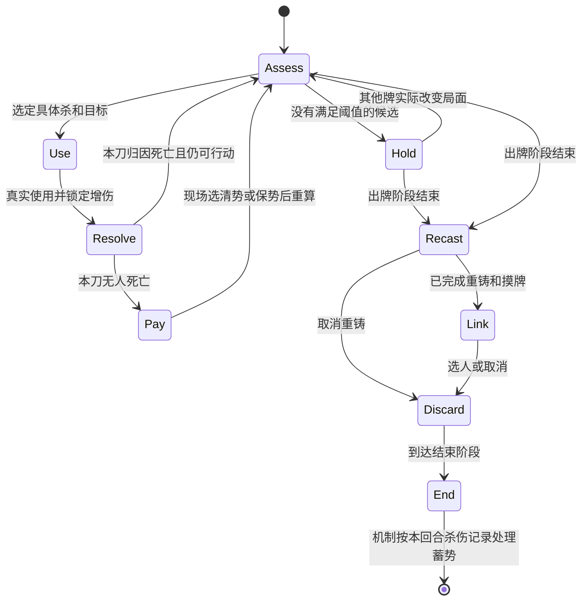

# 沈藏锋 AI 决策树工程初案 v1.5

更新于 2026-10-13。本文定义可编码的条件、动作和回退，依据 `shencangfeng.js` 与规则契约 v1.5。首版实战记录见 `artifacts/shencangfeng-ai-20261011/README.md`，本次白板与脆弱记录修订见 `artifacts/shencangfeng-ai-vulnerability-20261013/README.md`。阈值未经多局校准。

v1.1 按用户补充修订三处。允许以队友为连环起点换取足够高的团队收益；0 势也优先考虑蓄势；锁心按本回合能否补杀及结束时的属性转换决定留杀。下文已统一替换旧分支。

v1.2 将保势从“必须现场再出一刀”改为“付款后防御充足，而且保势明显改善下次出牌的收益”。现场连杀不再是必要条件。

v1.3 增加用户随后提出的全歼换友方阵亡、原生 AI 配合吃刀及留拆顺破防。新增规则见第 11 节，涉及旧条目时以新增规则为准。

v1.4 按用户明确要求，将其他武将视为白板，不识别其响应、防伤或救援技能；击杀统一按对方有 1 桃估计。真实结算仍由引擎执行，不改变武将技能。

v1.5 按用户澄清，多手牌且没有有效未出闪记录的目标不主动砍，即使其体力低、预测伤害过量。删除普通命中试刀出口；补齐仅供 AI 使用的未出闪记录。

## 1. 从参考角色继承什么

| 已核读的实现 | 本方案采用的结构 | 不直接照搬的部分 |
| --- | --- | --- |
| 鲜血仪葬殷华，`xianxueyinhua.js` 的 `xyDecideInitialRoute`、续打函数、留牌规划器 | 先决定进攻或等待；实际结算后重算；离散留牌档位；返回动作及原因 | 三杀、四杀爆发阈值不适合沈藏锋的一刀增伤。沈藏锋不是使用第一刀就必然失去蓄势 |
| 生潮息落绯，`luofei.js` 的殷潮消费、目标与留牌函数 | 先过滤负收益，再做优先级比较；明确定义脆弱；资源支付与目标选择分开；纯函数读取快照 | 不沿用“总留一血”。势与体力的兑换必须在每刀结算后决定 |

殷华旧 ver3 文档中的丹恩已与当前代码不同，本文只复用决策结构。落绯的目标加分也只是偏好，不能保证严格优先顺序。沈藏锋改用候选排序和明确选择，避免给一个低收益目标加分后意外超过禁止边界。

采用 Model the Domain 原则，将用牌窗口和付款窗口分开表达。预判“有击杀机会”与实际“本刀造成死亡”是两个字段。

## 2. 首版实现边界

首版覆盖自己的普通出牌、每刀拔刀选择、锁心选牌与选人、正常弃牌。普通响应继续使用引擎逻辑。回合外使用杀另外执行本方案的使用杀安全检查。

首版对普通单目标杀和标准连环做有限计算。出刀分析当前一刀；付款时另比较保势与清势对下一次出牌机会的影响。未来判断只用公开局面及可预期的杀来源，不搜索未知摸牌，不模拟整轮胜率，不承诺识别所有终局机会。

普通装备支持范围、仁王盾、藤甲、白银狮子、八卦、青釭的公开效果，并计算护甲。其他武将均按白板评估，不读取其技能来推断防伤、响应、救援或复活，也不借原生杀收益评分间接恢复这些判断。自身未支持的来源增伤、失血及弃牌交互仍保守处理。出杀合法性仍以引擎为准。

身份关系读取引擎的态度判断。自己单独识别，态度正为友方、负为敌方、零为未明。使用公开队伍时直接取队伍关系。不读取其他角色暗身份、暗手牌内容和牌堆顺序。不把公开人物的势力等同于队伍。

## 3. 决策输入及计算规则

每次选择新建只读快照。以下名字是拟新增字段，不是引擎现成 API。

| 字段 | 明确计算方法 |
| --- | --- |
| `window` | `PLAY` 主动出牌、`USE_OUTSIDE` 回合外使用、`RESPOND` 打出响应、`PAY` 拔刀、`RECAST` 锁心选牌、`LINK` 锁心选人、`DISCARD` 正常弃牌 |
| `shi`、`hp` | 当前势数、当前体力，不沿用上一刀数据 |
| `shaDamaged` | 本回合来源伤害历史存在牌名为杀、伤害大于 0 的记录，与当前机制一致 |
| `canBank` | 当前是自己的回合、`shaDamaged=false`，且没有已知的结束阶段跳过或回合中断。表示保持无杀伤即可蓄势，不保证未来不受干扰 |
| `endShi` | `shi + (canBank ? 1 : 0)`，用于锁心及付款后的未来势数估计 |
| `canRefill` | 三项同时成立：`canBank=true`；弃牌堆已有杀或本次拟重铸至少一张能正常进入弃牌堆的杀；没有已知阻止回收的替代效果。未知摸牌不算补杀来源 |
| `legalPairs` | 当前选择事件允许的具体杀与具体目标组合，同时通过牌可用、次数、目标、距离检查。首版主动规划实体手牌杀，未知转化杀不推算额外火力 |
| `vulnerable` | 目标手牌数不超过 1，或者存在有效未闪记录 |
| `hitTier` | 标准防具确定无效为 `BLOCKED`；自身来源伤害修正未支持为 `UNKNOWN`；可信原生队友配合，或目标脆弱且没有公开闪和有效八卦，记为 `HIGH`；其余为 `NORMAL`。其他武将技能不参与判断 |
| `damage` | 假定命中后，本刀按当前势、酒、原生属性、标准装备得到的伤害。高势强制按火杀算。未知修正返回 `UNKNOWN`，不填成零 |
| 救援假设 | 每个受害者固定按 1 桃估计，不扫描同阵营救援、不累计明牌桃，也不因其空手而降为 0 桃 |
| `killSignal` | `hitTier=HIGH`，自身来源伤害可预测，并且 `damage > target.hp`。即打入濒死后，1 桃仍无法救回 |
| `critical` | 自己；以及自己为忠臣或内奸时的公开主公。不得用暗身份识别他人的阵营职责 |
| `threat(target)` | 存在体力不超过 1 的 `critical`，目标为敌方、未翻面、手牌大于 0，且当前公开距离允许其用普通杀攻击该关键角色。只表示威胁信号，不表示已知其有杀 |
| `defenseGap` | 自己体力不超过 2，且手中没有当前可用的闪；或自己仅 1 体力且没有当前可用于自救的桃或酒 |

`killSignal` 是进攻信号，不能免除付款，也不能视为保证死亡。未知牌可能有多张闪或桃。首版保留失手分支，真实是否免付只读取机制的 `_nihilBadaoKilled`。

未闪记录借鉴殷华、落绯的私有字段模式，并扩展到全场杀和万箭。只根据实际未出闪事件记录，排除直击和规则不允许出闪。目标获得新牌时清除。记录不显示图标、不增加可见标记、不修改牌或技能结算，不在预测评分中生成；自身的下一次快照只读取记录。

公开牌只使用引擎提供的可见信息。公开闪可以影响命中估计，公开属性牌可以提示连环风险；救援固定按 1 桃估计，不跟踪暗牌。

### 3.1 允许以队友启动高收益连环

先按这张杀的实际属性处理，不能拿普通杀代表 3 势时的火杀。

```text
不是属性杀，或直接目标未横置
    → 只算直接目标

属性杀且直接目标横置
    → 算起点实际伤害
    → 起点伤害为 0，则不计传导
    → 起点正数伤害作为传导基数，逐个计算横置者自身修正
    → 下游藤甲增伤不累加到下一人
    → 青釭对直接目标忽略防具，不默认全链都忽略防具
```

普通单体进攻只选敌方且 `hitTier=HIGH` 的组合，低体力和高势不能绕过手牌门槛。杀的基础倾向由友敌关系决定，敌方为正、友方为负、中立为零，不调用原生杀收益来判断其他武将技能。属性杀的直接目标已横置时，枚举所有合法起点，包括友方；自己仍不能成为直接目标。

连环收益按整张杀计算一次，直接目标和每个传导目标不重复计数。对每个受害者计算 `hurt = min(damage, max(0,hp))`，避免把过量伤害当成额外收益。

```text
E = 敌方 hurt 总和 + 4 × 有击杀信号的敌人数
F = 自己、友方、身份未明者的 hurt 总和
    + 6 × 预计被打入濒死的己方或身份未明者人数
net = E - F
```

敌人的击杀信号按各自受到的伤害及固定 1 桃判断，命中档位继承连环起点。友方濒死成本直接按伤害达到当前体力计算，不指望桃救回。4 和 6 是初始权重，不是胜率或官方收益单位。

满足以下全部条件时，记为 `largeChain=true`，允许伤害队友，也允许选择队友作为起点。

1. 起点 `hitTier=HIGH`，实际属性伤害能启动连环，至少两名敌方受到正数伤害。
2. `net >= 4`；若 `F > 0`，还需 `E >= 2 * F`。
3. 自己及职责上必须保护的主公不会被本刀打入濒死。普通队友的濒死不硬禁，而是计入上述成本。
4. 自身来源伤害没有未支持的修正。作为主公时，不能依赖暗身份判断某队友是否忠臣；候选会令队友或未明者濒死时，首版拒绝该候选。
5. 按实际传导顺序截断已能确认的终局，不计算终局后的敌方伤害或击杀。不能用后续尚未发生的收益抵消先发生的己方败局。

例如一名 4 体力队友与三名 3 体力敌人横置，本刀分别造成 2 伤，无额外收益或代价。`E=6,F=2,net=4`，达到放行线。若这名队友只有 2 体力，`F=2+6=8`，同一刀不放行。若三名敌人均有击杀信号，则敌方击杀收益可以使牺牲普通队友的候选重新达到阈值。

真人或控制权不明确的队友不预测配合吃刀，起点仍检查手牌数量、公开闪和八卦。原生队友的配合条件见第 11.2 节。未命中时按真实结果付款，不改队友响应逻辑。

无友伤的连环可以按普通进攻或击杀路线选用。只要有友伤，无论直接砍敌人还是队友，都必须通过 `largeChain`。`BLOCKED` 不进攻，`UNKNOWN` 按第 2 节回退。

### 3.2 多一势是否有具体用途

`growthUseful` 只在 `canBank=true` 时计算。满足任意一项为真，否则为假。这个字段只判断额外门槛收益，不能因为它为假，就抹去获得 1 势及补杀的基础收益。

1. 当前范围外的敌人会进入势加一后的攻击范围，且同一具体杀的其他合法条件不变、收益为正。
2. 同一高命中候选在当前势不满足 `killSignal`，势加一后满足。
3. 当前恰有 2 势，同一杀变火后的整链结果满足 `largeChain`。

评估势加一使用纯数据计算，不临时给游戏角色加标记再恢复。未来目标体力、装备、横置状态沿用当前值，只作为等待信号，不作为保证。

## 4. 主动出牌决策树

桃、普通过牌、正常装备和控牌沿用引擎正收益选择，先于一般出杀执行。每次它们实际结算后重算杀候选。只在这些普通动作没有更高优先级候选时进入下面的树。

```text
重新读取当前状态，枚举具体杀和合法目标
│
├─ 没有合法组合
│   └─ HOLD，不出杀；不阻止其他牌
│
├─ 存在 largeChain 组合
│   └─ ATTACK_CHAIN，允许以队友为起点，选整链净收益最高的一组
│
├─ 存在无友伤且有 killSignal 的组合
│   └─ ATTACK_KILL，选其中排序最前的一组
│
├─ 满足下述资源兑现条件
│   └─ ATTACK_CASH，出一刀；未击杀时默认清势
│
├─ canBank=true 且 shi<3
│   └─ HOLD_BANK，默认蓄势，普通正收益不足以放弃本回合蓄势
│
├─ canBank=false，存在无友伤的普通正收益组合
│   └─ ATTACK_NORMAL；仍要求起点为HIGH，不因没有蓄势机会就攻击多手牌目标
│
├─ 存在 hitTier=HIGH 且 damage>=2 的普通正收益组合
│   且 shi>=3，growthUseful=false
│   └─ ATTACK_PRESS，出一刀后重新评估
│
└─ HOLD，保留杀，等待锁心与蓄势窗口
```

0 势也进入 `HOLD_BANK`。无击杀、高收益连环或必要资源兑现时，0 势等到 1 势，1 势等到 2 势，2 势等到 3 势。不是“有普通一伤可打就出杀”。本回合已经有杀伤时，不再为已经失去的蓄势资格继续忍刀。

蓄势看是否造成伤害，不是是否使用过杀。0 势出杀被闪、且全回合没有其他杀伤，结束时仍能加势补杀；但 AI 不以“希望对方出闪”作为蓄势手段。0 势命中并造成正数伤害，则本回合不能蓄势。

`ATTACK_PRESS` 不承诺下一刀继续，也不承诺失血保势。其默认失败成本是清势。高势但目标手牌很多、没有命中证据时，允许先控牌或等待；不因数字伤害高就自动出刀。

`ATTACK_CASH` 同时要求以下条件。

- `shi >= 2`，`defenseGap=true`，且已经没有普通正收益的治疗或过牌动作可先做。
- 出杀后至少有一个可保留的新牌名额。估算为 `min(shi, max(0, handLimit - protectedCount))`。`handLimit` 取当前引擎手牌上限，`protectedCount` 取出杀后剩余手牌中第 7 节第 1 档的牌数。自己 2 体力时至少要求 2 个名额，1 体力时至少 1 个。
- 有一个普通正收益、安全的杀候选；或者自己只有 1 体力、没有上述候选，但存在因公开仁王盾或藤甲而确定无伤害、无已知反击代价的合法敌方目标。
- 没有可见的用牌后反伤、失去手牌惩罚等会直接令自己濒死的交互。未支持的相关交互不走零伤兑现分支。

这是拿势换随机手牌，不保证摸到防御。手牌名额计算允许用新牌替换普通废牌，不把所有摸牌都算成留存收益。仅零伤兑现分支允许基础攻击收益为零，不能放行基础收益为负的攻击。

同一路由中的候选按下面的元组降序比较，不把各项混成一个总分。

```text
威胁关键角色的目标
→ killSignal
→ 命中档位 HIGH 优先
→ 整链 net 更高
→ 基于友敌关系的白板基础收益
→ 目标体力更低
→ 较低的材料保留成本
→ 行动顺序更近
→ 稳定牌序
```

所有加权都在通过安全过滤后进行。材料成本用本方案留牌表的纯评分计算，不在 AI 回调中递归调用自身修改后的 `get.value`。

`ATTACK_CHAIN` 单独先按 `net`、己方濒死人数更少、己方伤害更小排序，然后比较命中与材料成本，不用直接目标的敌我关系排序。己方直接目标基础收益为负，不能在后续选目标回调再次被过滤。

首版不专门搜索“先喝酒、再拆甲、再杀”的组合。引擎先执行普通有益准备动作，再重算本树。若对酒的默认逻辑不能识别下一刀收益，列为后续适配点，不假定已覆盖。

## 5. 拔刀付款决策树

此树在真实 `useCardAfter` 结算点调用，使用现场状态。

```text
本刀 _nihilBadaoKilled == true
    → 机制直接跳过付款，不进选择

当前 shi == 0
    → 返回 0，清 0 势、摸 0 牌

当前 hp <= 2
    → 返回 0，清势摸牌

失血相关交互未知，或付款后 defenseEnough=false
    → 返回 0，清势摸牌

存在下述 immediateGain 或 nextTurnGain
并且当前不是等待返回外层杀的嵌套追杀结算
    → 返回 1，失去 1 体力保势

否则
    → 返回 0，清势摸牌
```

`defenseEnough` 使用付款后的状态，初版要求以下条件同时成立。

- 失去 1 体力后仍至少 2 体力，没有额外致命代价。
- 至少一张当前可用的闪。
- 付款后至少 3 体力，或另有一张可用的桃或自救酒，或至少两张可用闪。
- 没有已经公开、在下次行动前会绕过这些防御造成致命结果的交互。防御牌只能按已知适用范围计入，不把闪当成能防止所有伤害。

这些是可调整的初始阈值。有一张闪而付款后仅剩 2 体力，不直接认定防御充足。

`nextTurnGain` 按以下有限步骤计算，不要求当前剩余杀次数。

1. 下一次自己的出牌阶段没有已知的跳过障碍。首版在翻面或判定区有乐不思蜀时不采用未来保势分支。
2. 手里已经有可保留到下回合的杀，或 `canRefill=true`，有正常结束补杀来源。下一轮未知摸牌不按必定摸杀计算。需要依赖现有杀时，锁心必须按第 6.1 节将它保留或用补杀替代。
3. 对保势和清势分别构建未来快照。若 `canBank=true`，两者都计入结束阶段加的 1 势，即分别为 `shi+1` 与 `1`；否则分别为 `shi` 与 `0`。未来使用次数按新的出牌阶段计算，不沿用本阶段已耗尽的次数。
4. 在保势快照中，存在体力不超过 2、手牌不超过 1 的敌人，并有无友伤的击杀信号；或者存在通过 `largeChain` 的高收益连环。防具、距离、强制火属性、救援与友伤仍按原判断处理。
5. 清势快照中，最佳候选失去相应击杀信号或高收益连环资格，或所有对应目标均超出攻击距离。若清势后仍有同等档位的攻击机会，就不为单纯增加过量伤害而失血。

目标残血少牌是下一轮机会的启发式信号，不是它下回合仍维持此状态的保证。它可能先摸牌、回复或解除连环。记录目标是否在自己之前行动及当前证据，下一次真实选牌重新判断，不绑定旧目标。补回杀的颜色未知时，沿用第 6.2 节的红黑均通过检查，不假定得到特定属性或颜色。

`immediateGain` 是更近的机会。若当前确有可用杀和剩余次数，就用当前势数比较保势与清势，不提前加入结束阶段的 1 势。存在保势后才成立的无友伤击杀，或带敌方击杀信号的 `largeChain` 时为真。该分支能支持连弩，却不再是普通保势的前提。

评估未来只调用候选分析，不递归调用完整付款树。每次付款都重新检查体力及防御，不能因上一刀决定保势，就连续失血到危险血线。清势摸牌仍是没有高价值后续机会时的默认选择。

保势失血完成后重新读取游戏状态。清势后同样重新检查伤害、属性、范围、次数和目标。不得复用原计划的远距离目标。

每张杀独立记账。外层青龙杀被闪、内层杀击杀，不代表外层也免付款。首版不主动采用青龙追杀组合，嵌套付款一律按清势回退。真人仍可正常选择所有合法选项。

## 6. 锁心先选牌，摸完再选人

### 6.1 重铸牌集合

进入 `phaseUseEnd` 后执行以下规则。出牌阶段已经结束，摸到桃不产生“再主动吃桃”的计划。

1. 枚举当前手牌杀，无杀就结束。先以全部杀作为拟重铸集合，检查 `canBank` 与本方案下的 `canRefill`。
2. `canRefill=true` 且当前 `shi>=2` 时，不留杀，全部重铸。结束时至少 3 势，补回的任何杀都按火杀使用。
3. `canRefill=true` 且当前 `shi<2` 时，只保留一张原生属性杀，其余全部重铸；没有属性杀则全部重铸。保留属性杀是为了补回普通杀后仍有连环选择，不是为了保留杀的数量。
4. `canRefill=false` 时，默认留一张杀，其余重铸。这包括本回合已有杀伤、结束阶段已知不可达、以及重铸杀已知无法进入可回收弃牌堆的情况。
5. 需要保留时，先比较按预计结束时属性可形成的 `largeChain`，再比较对敌方的合法正收益目标数，最后按基础保留价值及稳定牌序选一张。属性杀按预计势是否达到 3 判断，不把将被强制改火的雷杀当额外优势。
6. 若 `defenseGap=true`，把拟保留的最后一张也重铸。若第 6.2 节判定必须解链、但目前没有任何重铸名额，也重铸这一张。不因场上存在有利混合链就自动清掉唯一杀。
7. 集合为空则取消发动，否则只重铸集合中的牌。选牌完成后按实际集合重算补杀预期。取消重铸的单张属性杀仍在手里，无需假定另补一张才能保留攻击资源。

本方案把“不造成杀伤、锁心换牌、结束加势补杀”作为正常资源循环。重铸出去的杀通常进入弃牌堆，能提供补杀来源，但补回的是引擎顺序中的杀，不保证原生属性、颜色或具体牌。若后续公开事件移走弃牌堆的杀，记录预期落空；不为无法预知的抢牌一律保留普通杀。

### 6.2 铁索目标集合

2026-10-12按用户实测修订。重铸摸牌完成后重新检查合法目标，令 `limit` 为实际重铸数与合法人数的较小值。敌方布局和友方跳板分开判断。

```text
已有友方横置
    → 检查保持或补全后的完整链是否安全且收益足够
    → 危险且不能安全补全时，优先解友方，不同时扩大危险链

纯敌方布局
    → 选择未横置、合法、明确视为敌人的目标，最多 limit 人
    → 不看敌方手牌，不要求 HIGH、大链收益或当前有属性杀
    → 只有一个名额也可先连一个；低势可以提前布局
    → 不浪费名额重置已连敌人，不把中立或未明者直接当敌人

考虑新增友方跳板
    → 使用实际保留或可预期补回的属性杀预测
    → 评估最终完整组合，包括“1名队友＋2名敌人”
    → 可信配合、整链收益、牺牲代价和关键角色保护均通过才连队友
    → 不要求中间的两人组合已经有高收益

无合法敌方布局，也无可接受的友方跳板或解链对象
    → 取消选人，保留重铸收益
```

未来伤害预测用于友方风险和跳板收益判断，不作为纯敌布局门槛。“预计结束时势”按当前杀伤害历史推算是否加一。若结束阶段已知不可达，则不加；未来距离使用预计势与公开装备计算。

预期补回火杀的颜色未知时，不能假定能破仁王盾。未来没有可靠材料、行动受阻或有公开敌方属性威胁时，不新增需要己方承担风险的跳板；这些条件不禁止单纯连敌人。自己和职责上须保护的主公不得因友方方案进入预期濒死。

友方方案采用有限组合搜索，先形成敌方布局，再尝试加入一个友方；名额不足时可以为其调整一个敌方名额。整个最终组合按原有友伤收益和保护边界评估。实际出杀仍另走攻击决策树，连上敌人不代表必须马上出杀。

解链与新增敌链仍是互斥路线。进入解链分支后不同时加敌链，避免解除己方连环被无懈后留下新增加的混合链。与旧稿的区别是，有利的队友起点可以保留，不再无条件解掉。首版暂不主动把原本未横置的队友加入链中。

若属性伤害来源或特殊铁索效果无法判定，仍可重铸，选人回退为空。此首版暂不计算“给某个敌人解链能阻止对方利用藤甲起点”的组合。

## 7. 正常弃牌与响应

正常弃牌用以下档位排序，按实际手牌上限截断。首张指当前自己持有的同名牌中的一张。相同档位用原始基础值和稳定牌序排序，不递归调用修改后的牌值。

| 档位 | 牌 |
| --- | --- |
| 1 | 一张桃、一张闪；1 体力时第一张酒也进入本档。同档顺序为桃、1体力酒、闪 |
| 2 | 第一张无懈、可在下个出牌阶段改善当前装备的第一张防具或防御马 |
| 3 | 按第 6.1 节规则仍需保留的至多一张杀、其他桃、无中生有 |
| 4 | 其他有正常用途的牌、第二张闪 |
| 5 | 无需保留的杀、重复且无改善的装备 |

同一张牌只占一个名额，按其最高档位归类。攻击杀不能挤掉已有核心防御。`defenseGap=true` 时，保留杀降至第 4 档。

正常弃牌再次读取本回合是否有杀伤及弃牌堆状态。能补杀且当前至少 2 势时，不给普通杀额外保留分；不足 2 势时保留的一张属性杀才进第 3 档。锁心可能摸到新的杀，不能沿用重铸前的牌 ID 集合。此时是否补杀以真实弃牌堆为准，不能引用一个未执行的重铸计划。

该评分仅接本人 `chooseToDiscard` 且直接父事件为 `phaseDiscard` 的窗口。过河拆桥、贯石斧代价、响应、交牌不使用这张保留表。

南蛮、决斗的打出杀走普通响应，不触发本方案忍刀判断。借刀等要求使用杀的窗口会产生拔刀成本，按当前事件的合法性重新评估。若发生在自己的回合，仍保留 `canBank` 分流，不能因不属于普通出牌按钮就忽略蓄势。若发生在他人回合，本次杀伤不抹去下次自己回合的蓄势资格；0 势可用正收益无友伤杀，有势仅在无友伤击杀或 `largeChain` 成立时使用。其他情况可拒绝，并接受该牌本身规定的后果。首版不额外比较借刀交武器与清势的精确价值，作为已知策略损失。

## 8. 状态机及代码接入



图描述普通完整回合。跳阶段、回合中断、角色死亡时按真实事件退出；不得由 AI 人工补发锁心或蓄势。`HOLD` 只指不出杀，不等于结束整个出牌阶段。

拟增加以下纯函数，统一返回动作、原因码和候选 ID。

| 函数 | 输入和输出 |
| --- | --- |
| `analyzeSlash(snapshot, card, target)` | 返回合法性、整链伤害、命中档位、敌方击杀信号、E、F、net、largeChain 与基础收益 |
| `decideSlash(snapshot, candidates)` | 返回 `HOLD`、`HOLD_BANK` 或五种进攻动作，以及唯一选中的材料和目标 |
| `chooseBadaoCost(snapshot, useRecord)` | 返回 `CLEAR_SHI` 或 `LOSE_HP`，映射到选择索引 0 或 1 |
| `chooseRecastCards(snapshot)` | 返回确定的牌 ID 集合，可为空 |
| `chooseLinkTargets(snapshot, limit)` | 返回确定的目标 ID 集合，可为空 |
| `chooseKeepCards(snapshot)` | 返回按实际上限截断后的保留牌 ID 集合 |

每个返回都带 `reason`，例如 `NO_SAFE_TARGET`、`KILL_SIGNAL`、`LARGE_CHAIN_VIA_ALLY`、`BANK_SHI_AND_REFILL`、`RECAST_ALL_BEFORE_FIRE`、`KEEP_NATIVE_ELEMENTAL`、`CASH_FOR_DEFENSE`、`KEEP_FOR_NEXT_TURN`、`KEEP_FOR_IMMEDIATE_LETHAL`、`CLEAR_FOR_SAFETY`。记录方案原因不改变任何规则标记。

接入位置如下。

1. 在沈藏锋技能增加 `onChooseToUse`。仅包装自己当前的普通出牌选择事件，保留原 `ai1` 与 `ai2`，不改原合法性函数。杀牌的 `ai1` 依据本树给分，普通进攻可沿用殷华的 `0.0001` 作为收尾顺序。非杀调用原回调。
2. 杀的 `ai2` 对唯一计划目标返回正分，对本次其他目标返回负分。这里允许计划中的队友获得正分，不再调用单体“禁止友伤”过滤。卡牌与目标必须来自同一个候选计划。非杀目标用原回调。额外必选目标无法计算时放弃该 AI 候选，不禁止真人合法选牌。
3. 单独把第 7 节规则接入已识别的回合外使用杀窗口。普通 `chooseToRespond` 不包装。未知使用窗口不得误套“本阶段剩余次数”或“等待蓄势”。
4. 将 `shencangfeng.js` 中拔刀恒定返回 0 的回调替换为 `chooseBadaoCost`，不改强制二选一规则。
5. 锁心选牌增加计划内牌的 AI 评分及数量控制。选人按重铸后的新计划评分。通过正常取消得到零目标，不把 `[1,max]` 改成一个新规则。
6. 正常弃牌用 `mod.aiUseful`，严格检查直接父事件。参考落绯与殷华的限定条件。

为保证顺序不是“只在纸面上优先”，实现时需检查引擎选牌与选目标最终采用的结果。不仅测试辅助函数返回值。

快照在每个选择事件内缓存。同一事件重试选牌时，候选必须按实际选中牌重新核对。游戏发生摸牌、使用牌、伤害、死亡、装备或标记变化后丢弃计划。AI 评分过程不增删势、不扣血、不写路线承诺、不执行模拟 `useCard`。

基础收益在运行时适配层采集，纯函数不调用引擎。优先包装事件的 `ai1/ai2`，避免为了取得基础分，在 `effect.player_use` 内又递归调用 `get.effect`。其他技能的效果仍由原收益函数提供。

## 9. 首轮必须验证的输入和输出

下表保留设计时的测试规格；实际已执行的用例、覆盖与版本结果见 `artifacts/shencangfeng-ai-20261011/README.md`，不能将整表视为已经完成实机验证。

| 输入 | 预期动作 |
| --- | --- |
| 2 势，敌人 2 血空手、无防具或救援，其他安全条件成立 | 当前 3 伤已满足击杀信号，出刀，不等 3 势 |
| 3 势，黑杀对仁王盾，自己 4 血 | 不进入普通进攻，不把增伤当破盾 |
| 3 势，敌人横置、自己也横置，自己预计被打入濒死 | 拒绝该火杀，不能用后续敌方伤害抵消先发生的自身濒死 |
| 属性杀起点为 HIGH 命中的4体力队友，另有三名3体力敌人横置，各受2伤，无其他修正 | E=6、F=2、net=4，允许砍队友启动连环 |
| 与上一行相同，但队友只有2体力 | F=8、net=-2，拒绝该候选 |
| 非主公使用者，普通2体力队友和三名2体力敌人各受3伤，起点HIGH，敌人均满足预留1桃后的过量杀伤，自身伤害可预测 | E=18、F=8、net=10，允许承担队友濒死成本 |
| 队友起点有公开可用闪，且不是可信原生AI配合 | 不假定其配合不闪，不进入HIGH连环分支 |
| 杀打到濒死后被桃救回 | 实际死亡标志为假，进入付款 |
| 3 势、2 血，杀被闪 | 清 3 势摸 3；若本回合从未有杀伤且到达结束阶段，再得 1 势 |
| 0 势，杀未死人 | 清 0 摸 0，不失血 |
| 0 势，本回合无杀伤，只能对一名3体力敌人造成普通1伤 | HOLD_BANK，放弃普通一伤以保留加势补杀 |
| 0 势，本回合无杀伤，但敌方有可击杀目标 | 可打破等待；实际造成伤害后不再蓄势 |
| 0 势，出杀被闪，之后本回合也无杀伤 | 到达结束阶段时加1势，弃牌堆有杀则补杀 |
| 3 势、4 血、连弩、另有杀和闪，下一刀保势时满足击杀信号，清势则不满足 | 无未知代价且非嵌套，失血保势；随后重新选下一刀 |
| 3势、4体力、有闪，杀次数已用完；下回合有留存杀，敌方2体力1手牌，无公开硬防御；保势有击杀信号而清势无 | 失血保势，不要求本回合还能出杀 |
| 与上一行相同但手里没有杀，本刀被闪，正常结束能够补杀 | 允许以补杀为下回合材料，仍可保势；比较时两种付款都加结束阶段的1势 |
| 没有留存杀，本回合已有杀伤，也没有其他已支持的确定杀来源 | 不假定下次摸到杀，清势 |
| 3体力、仅一张闪且无桃酒，其他条件支持未来攻击 | 付款后2体力，防御不达阈值，清势 |
| 3体力、有闪和桃，下回合具备保势才能成立的高收益攻击 | 可失血保势，付款后2体力且有防御与救援资源 |
| 未来低血目标在清势后也同样有击杀信号、在范围内 | 清势，不为过量伤害失血 |
| 自己翻面或有乐不思蜀，且当前没有立即进攻机会 | 不依赖下一回合出刀，清势 |
| 先有杀伤，第二刀被闪并清势 | 不恢复本回合蓄势资格 |
| 清势后原本够得到的远敌已超范围 | 下一刀重新过滤，不能继续选旧目标 |
| 本回合无杀伤、1势，一张雷杀和两张普通杀，重铸正常进弃牌堆 | 留雷杀，重铸两张普通杀；结束阶段到2势并补杀 |
| 本回合无杀伤、1势，只有普通杀 | 全部重铸，结束阶段到2势并补杀 |
| 本回合无杀伤、2势，手中有雷杀和普通杀 | 全部重铸，结束到3势，补回的杀统一按火杀使用 |
| 本回合已有杀伤、2势，手中两张杀且无防御缺口 | 没有结束补杀，保留一张，其余重铸 |
| 本回合无杀伤但重铸杀受已知替代效果影响不会进入弃牌堆，弃牌堆也无杀 | canRefill=false，保留一张，不假定补杀 |
| 唯一杀，自己与其他人横置，futureChain=false且需要解链 | 重铸唯一杀获取解链名额 |
| 重铸后没有正收益铁索目标 | 取消第二段，已完成换牌不回滚 |
| 队友和多名敌方横置，futureChain=true | 保留队友起点，不自动解链；只在净收益增加时新增敌链 |
| 已进入解链路线，同时存在可新增敌链的目标 | 本次只解链，不同时新增敌链 |
| 锁心重铸摸到桃 | 不在已结束的普通出牌阶段安排主动吃桃 |
| 南蛮要求打出杀 | 普通响应，不按出刀付款树阻止交杀 |
| 1 血、4 势、无防御，唯一合法黑杀被仁王盾确定挡住，无更好过牌或已知反击 | 允许零伤兑现，清势换牌，不许失血保势 |
| 青龙内层杀击杀，外层被闪且未造成死亡 | 两张杀独立归因，不能把内层死亡写给外层 |
| 同一状态重复评分 | 同一动作、材料、目标和原因；无副作用，无递归循环 |

## 10. 依据与未完成项

已经核对当前源文件及以下文档。

- [沈藏锋机制](F:/AI_project/nameless_game/nihilphile/nihilphile武将包/module/shencangfeng.js:83) 的蓄势、拔刀快照、付款与锁心。
- [规则契约 v1.5](F:/AI_project/nameless_game/nihilphile/doc/taskboard/shencangfeng/rule-contract-v1.5.md)。
- [历史行为稿](F:/AI_project/nameless_game/nihilphile/doc/沈藏锋_AI行为逻辑_最终版.md)，仅作规则约束与场景参考。
- [殷华首杀路线](F:/AI_project/nameless_game/nihilphile/nihilphile武将包/module/xianxueyinhua.js:520) 与 [AI 接线](F:/AI_project/nameless_game/nihilphile/nihilphile武将包/module/xianxueyinhua.js:1069)。
- [落绯纯决策](F:/AI_project/nameless_game/nihilphile/nihilphile武将包/module/luofei.js:82) 与 [未闪记录](F:/AI_project/nameless_game/nihilphile/nihilphile武将包/module/luofei.js:460)。
- 本机无名杀源码的 [onChooseToUse 调用](F:/AI_project/nameless_game/无名杀子琪懒人包v1.11.3-win32-x64/resources/app/src/noname/library/element/content.js:5103)、[AI 选牌选目标](F:/AI_project/nameless_game/无名杀子琪懒人包v1.11.3-win32-x64/resources/app/src/noname/library/element/content.js:5219) 和 [默认回调](F:/AI_project/nameless_game/无名杀子琪懒人包v1.11.3-win32-x64/resources/app/src/noname/library/element/player.js:5576)。

注意旧依据稿把攻击范围也写成使用时快照。当前代码只有本刀增伤快照，范围实时读取势。本方案按当前代码与契约处理，每刀重新验范围。

首版实战及其后修订记录见 `artifacts/shencangfeng-ai-20261011/README.md`。沈藏锋已按用户要求解除默认 AI 禁选。当前白板策略不模拟其他武将的复杂技能，贯石斧、青龙、寒冰、多直接目标及特殊转化杀也不在首版完整支持范围内。

## 11. v1.3 用户增量

### 11.1 普通队友牺牲与关键角色保护

```text
属性连环候选
├─ 预计自己或必须保护的主公濒死 → 拒绝
├─ 起点命中可信，且公开 versus 阵营的全部存活敌人都有击杀信号
│  └─ 自身伤害可预测 → 允许普通队友阵亡，可突破通常 E >= 2F 门槛
└─ 其他情况 → 继续使用原整链收益门槛
```

该例外不能依据暗身份判断已经全歼。它只是预测，不修改真实死亡归因或免付款标志。

### 11.2 原生队友配合吃刀

只对确认由原生 AI 控制、对沈藏锋为正态度的队友预测配合。队友横置、属性杀、另有横置者时，允许提高起点命中档位；公开闪或八卦不自动否定这类配合。真人、外部玩家代理及不明确的联机控制状态不作该假设。

原生响应和控制权研究见 `docs/沈藏锋_AI原生连环配合调研.md`。白板策略不再检查其他武将的 `noShan/useShan`，实际响应仍可能不同。锁心只在最终整组收益或明确全歼例外成立时连入队友，自己与主公保护始终先判。

### 11.3 留拆顺，刀前破防

```text
选择过河拆桥／顺手牵羊
├─ 有合法杀；敌人恰好2张手牌、无装备/判定牌，且手牌可被实际移除
│  ├─ 模拟少1张后，出刀跨入击杀／高收益连环／高命中压制 → 先对该人使用该拆顺
│  │  └─ 真正拆顺结算后重新取快照，满足出刀条件才出杀
│  └─ 未跨入有效出刀条件 → 不建立两步计划
├─ 无上述计划，存在公开危险装备、队友乐不思蜀等原生正收益用途 → 保留默认决策
├─ 仍处于低势蓄势 → 可保留1张拆顺，避免普通多手牌一换一
└─ 高势且没有更好的准备机会 → 回退原生正收益使用，避免无限囤牌
```

只搜索一次拆顺加一次杀，不预写后续动作。不能假定随机移除的一定是已公开的闪，也不能假定拆顺未被无懈。材料与目标配对评分，实际结果变化后废弃旧计划。正常弃牌仍先保防御，再提高保留一张拆顺的优先级。

### 11.4 未来属性收益

纯函数按未来势数决定属性，并计算藤甲等标准装备，避免漏掉 2 势到 3 势的火杀机会。当前、未来及补回的杀都不借原生收益推断其他武将技能。

其他角色的急救、防伤和复活均不进入白板预测。自身未支持的来源增伤仍影响整张杀的风险判断，不能据不确定的自身伤害牺牲队友或主公。

### 11.5 多手牌等待与未出闪记录

此前因一局长期蓄势而加入的 `NORMAL_HIT_TRIAL` 已按用户要求撤销。其他武将按白板不代表忽略手牌。直接目标多于 1 手牌且没有有效未出闪记录时，不执行普通进攻、击杀或常规清势兑现；可以等待或先拆顺破防。

有效未出闪记录使目标进入脆弱判定，但不能越过公开闪、有效八卦和防具阻挡。可信原生队友配合仍可作为高命中连环起点；连环后续受害者不要求缺闪证据。自身 1 血、目标防具挡杀的紧急清势换牌例外，也必须满足目标手牌少或有未出闪记录。
